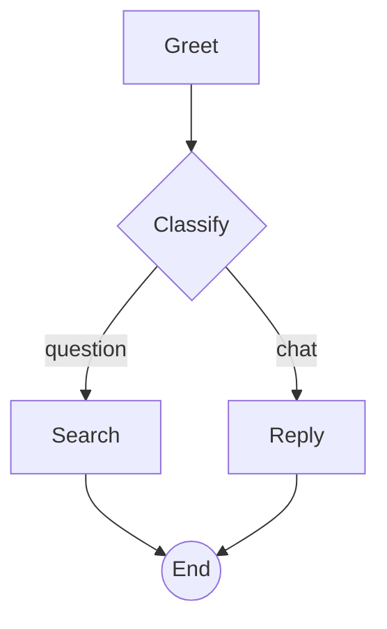

# AISOP — AI Standard Operating Protocol

[中文版 README](README_CN.md)

[](LICENSE)

**An open protocol for defining structured AI programs using Mermaid or JSON flow graphs.**

AISOP enables defining multi-step AI programs with visual (Mermaid) or structural (JSON) control flow — branching, parallel execution, sub-tasks, and error handling — all in a single portable JSON format.

## Why AISOP?

| Approach | Definition | Portable | Machine-readable | Token-efficient |
|----------|-----------|----------|-----------------|-----------------|
| Natural language prompts | Free text | Yes | No | No |
| Python / YAML workflows | Code / config | No | Partially | No |
| Visual builders (Dify, etc.) | Proprietary | No | No | No |
| **AISOP** | **Mermaid + JSON** | **Yes** | **Yes** | **Yes** |

AISOP files are plain JSON with flow graphs (Mermaid or JSON) — readable by any language, editable in any editor, versionable in git, and optimized for LLM comprehension.

## File Format

```json
[
  { "role": "system", "content": { "protocol": "AISOP V1.0.0", ... } },
  { "role": "user",   "content": { "instruction": "...", "aisop": { ... }, "functions": { ... } } }
]
```

| Element | Purpose |
|---------|---------|
| `system` | Program metadata (identity, version, description) |
| `user` | Instruction, flow graph, and function definitions |

## Quick Example

```json
[
  {
    "role": "system",
    "content": {
      "protocol": "AISOP V1.0.0",
      "axiom_0": "Human_Sovereignty_and_Wellbeing",
      "id": "greeting_assistant",
      "name": "Greeting Assistant",
      "version": "1.0.0",
      "summary": "Classify user intent and respond",
      "flow_format": "mermaid"
    }
  },
  {
    "role": "user",
    "content": {
      "instruction": "RUN aisop.main",
      "user_input": "{user_input}",
      "aisop": {
        "main": "graph TD\n    greet[Greet] --> classify{Classify}\n    classify -->|question| search[Search]\n    classify -->|chat| reply[Reply]\n    search --> end_node((End))\n    reply --> end_node"
      },
      "functions": {
        "greet":    { "step1": "Say hello to the user" },
        "classify": { "step1": "Classify user intent as 'question' or 'chat'" },
        "search":   { "step1": "Search for relevant info" },
        "reply":    { "step1": "Generate a friendly reply" },
        "end_node": { "step1": "Output final response" }
      }
    }
  }
]
```

The flow graph (Mermaid format):



## Key Features

- **Dual Flow Format** — Mermaid string (AI-native) or JSON flow object (code-native), mixable in the same program
- **14+ Control Flow Patterns** — sequential, decision, parallel fork/join, delegate, loop, convergence, error routing, batch iterate, retry, data isolation, step-level sub-task, agent dispatch, HITL confirmation, runtime assertion
- **Three-Layer Separation** — metadata, flow graph, function definitions
- **Topology / Behavior Split** — flow graph defines connections, functions define runtime behavior
- **Sub-task Support** — `main` + named sub-tasks via delegate nodes or step-level `RUN aisop.<sub>`
- **Reserved Keys** — 8 runtime behavior keys in functions (join, map, on_error, retry_policy, context_filter, output_mapping, constraints, execute_mode)
- **`sys.*` System Calls** — 24 protocol-reserved system calls for human confirmation (🔒 inviolable `sys.io.confirm`), I/O, assertions, model invocation, code execution, and state management (see §6)
- **Error Handling** — Mermaid `-.->` error edge + function-level `on_error` type routing + 6 sys.* error types
- **Variable Substitution** — `{system_prompt}`, `{user_input}` replaced at runtime
- **Token Efficient** — Mermaid uses ~50% fewer tokens than JSON flow format
- **Zero Dependencies** — Reference implementations in Python and JavaScript, stdlib only
- **AI-Agnostic** — Works with any AI runtime

## Flow Formats

AISOP supports two flow graph formats. Both can coexist in the same program.

### Mermaid (string)

| Shape | Syntax | Meaning |
|-------|--------|---------|
| Rectangle | `name[text]` | Process — execute and proceed |
| Diamond | `name{text}` | Decision — conditional branching |
| Circle | `name((text))` | End — terminate task |
| Rectangle | `name[aisop.sub]` | Delegate — call sub-task |

| Edge | Syntax | Meaning |
|------|--------|---------|
| Solid arrow | `-->` | Normal flow (next) |
| Labeled arrow | `-->\|label\|` | Branch (conditional) |
| Dashed arrow | `-.->` | Error routing |

### JSON Flow (object)

| Field | Type | Meaning |
|-------|------|---------|
| `next` | string[] | Next node(s). 1 = sequential, 2+ = parallel fork |
| `branches` | object | Conditional branching: `{label: target}` |
| `error` | string | Error handler node |
| `delegate_to` | string | Call a sub-task by name |
| `wait_for` | string[] | Wait for nodes before proceeding (join) |
| `{}` | — | End — terminate task |

## Control Flow Patterns

| Pattern | Mermaid (§4.2) | JSON Flow (§4.3) | Functions (§5) / sys (§6) |
|---------|---------------|-----------------|----------------|
| Sequential | `A --> B` | `"next": ["B"]` | — |
| If/else | `A -->\|yes\| B`, `A -->\|no\| C` | `"branches": {"yes": "B", "no": "C"}` | — |
| Switch (N-way) | `A -->\|label\| B`, ... | `"branches": {"label": "B", ...}` | — |
| Parallel fork | `A --> B`, `A --> C` | `"next": ["B", "C"]` | — |
| Parallel join | `B --> D`, `C --> D` | `"wait_for": ["B", "C"]` | `"join": {"merge_strategy": "array"}` |
| Loop | Branch target → earlier node | Branch target → earlier node | — |
| Sub-task | `A[aisop.sub]` | `"delegate_to": "sub"` | — |
| Convergence | Multiple → same target | Multiple → same target | — |
| Error routing | `A -.-> E` | `"error": "E"` | `"on_error": {"timeout": "t"}` |
| Batch iterate | — | — | `"map": {"items_path": "..."}` |
| Retry | — | — | `"retry_policy": {"max_attempts": 3}` |
| Data isolation | — | — | `"context_filter": {"include": [...]}` |
| Step-level sub | — | — | step text: `RUN aisop.sub` |
| Agent dispatch | — | — | `"execute_mode": "agent"` |
| HITL confirmation | — | — | `sys.io.confirm('...')` (§6.2) |
| Runtime assertion | — | — | `sys.assert('...', '...')` (§6.5) |
| Background job | — | — | `sys.run.bg('...')` (§6.4) |

## Getting Started

**Python:**

```bash
cd reference/python
python run.py example.aisop.json
python test_all.py
```

**JavaScript:**

```bash
cd reference/javascript
node run.js example.aisop.json
node test_all.js
```

## Project Structure

```
AISOP-Protocol/
  specification/
    aisop-spec.md              # Protocol specification (V1.0.0)
    aisop-spec_CN.md           # Protocol specification — Chinese
  reference/
    python/
      flow_runtime.py                # Python reference implementation
      example.aisop.json             # Example flow definition
      example_syscalls.aisop.json    # Advanced example with sys.* calls
      test_all.py                    # Test suite (44 tests)
      run.py                         # CLI tool
      pyproject.toml                 # Python package metadata
      LICENSE                        # Apache 2.0 license (per-package)
      NOTICE                         # Apache 2.0 attribution notice (per-package)
      README.md                      # Implementation guide
    javascript/
      flow_runtime.js                # JavaScript reference implementation
      example.aisop.json             # Example flow definition
      example_syscalls.aisop.json    # Advanced example with sys.* calls
      test_all.js                    # Test suite (44 tests)
      run.js                         # CLI tool
      package.json                   # npm package metadata
      LICENSE                        # Apache 2.0 license (per-package)
      NOTICE                         # Apache 2.0 attribution notice (per-package)
      README.md                      # Implementation guide
  docs/
    index.md                                  # Documentation site home
    topics/
      what-is-aisop.md                        # Introduction and rationale
      comparison-mermaid-vs-jsonflow.md       # Mermaid vs JSON Flow comparison
      comparison-mermaid-vs-jsonflow_CN.md    # Comparison — Chinese
      performance-mermaid-vs-jsonflow.md      # Performance analysis
      performance-mermaid-vs-jsonflow_CN.md   # Performance analysis — Chinese
    adrs/
      adr-001-mermaid-as-primary-format.md    # ADR mirror (mkdocs site)
      adr-002-sys-io-confirm-immutability.md  # ADR mirror (mkdocs site)
  adrs/
    adr-template.md                # ADR template
    adr-001-mermaid-as-primary-format.md       # Format choice rationale
    adr-002-sys-io-confirm-immutability.md     # Axiom 0 enforcement decision
  README.md
  README_CN.md
  CONTRIBUTING.md                # Contribution guidelines
  CONTRIBUTING_CN.md             # 贡献指南
  CODE_OF_CONDUCT.md             # Community standards (Axiom 0 pledge)
  GOVERNANCE.md                  # Tripartite Chain governance model
  SECURITY.md                    # Vulnerability reporting policy
  LICENSE                        # Apache 2.0 license
  NOTICE                         # Apache 2.0 attribution notice
  CHANGELOG.md                   # Release notes
  mkdocs.yml                     # MkDocs documentation site config
```

## AIXP Labs [aixp.dev](https://aixp.dev)

AIXP Labs develops and maintains the following core projects:

| Project | Description | Website |
|---------|-------------|---------|
| [HSAW](https://hsaw.dev) | Human Sovereignty and Wellbeing — Axiom 0 white paper (foundation) | hsaw.dev |
| [AILP](https://ailp.dev) | AI List Protocol — agent discovery and capability advertising | ailp.dev |
| [AIVP](https://aivp.dev) | AI Value Protocol — international commerce, crypto asset settlement | aivp.dev |
| [AIRP](https://airp.dev) | AI RMB Protocol — Mainland China commerce, RMB licensed settlement | airp.dev |
| [AIBP](https://aibp.dev) | AI Bot Protocol — social communication and trust | aibp.dev |
| [AIAP](https://aiap.dev) | AI Application Protocol — governance and compliance | aiap.dev |
| [AISOP](https://aisop.dev) | AI Standard Operating Protocol — flow program definition (this project) | aisop.dev |
| [SoulBot](https://soulbot.dev) | AI agent runtime and framework | soulbot.dev |
| [SoulACP](https://soulacp.dev) | Adapter library — bridging CLI tools and LLM providers | soulacp.dev |

## Axiom

AISOP is grounded in **Axiom 0: Human Sovereignty and Wellbeing** — AI systems exist to serve humanity, not replace or dominate it. All implementations must enforce this axiom at the highest execution priority. See [§0 of the specification](specification/aisop-spec.md) for the full text.

## Contributing

See [CONTRIBUTING.md](CONTRIBUTING.md) for guidelines / 见 [CONTRIBUTING_CN.md](CONTRIBUTING_CN.md) 了解贡献指南。

## Community & Governance

- [Code of Conduct](CODE_OF_CONDUCT.md) — Community standards aligned with Axiom 0
- [Governance](GOVERNANCE.md) — Tripartite Chain model (Seed / Authority / Executor)
- [Security Policy](SECURITY.md) — Vulnerability reporting and `sys.io.confirm` immutability
- [Architecture Decision Records](adrs/) — Design rationale for major decisions

## License

[Apache License 2.0](LICENSE) - Copyright 2026 AIXP Labs AIXP.dev | AISOP.dev

---

Align Axiom 0: Human Sovereignty and Wellbeing. Version: AISOP V1.0.0. www.aisop.dev
