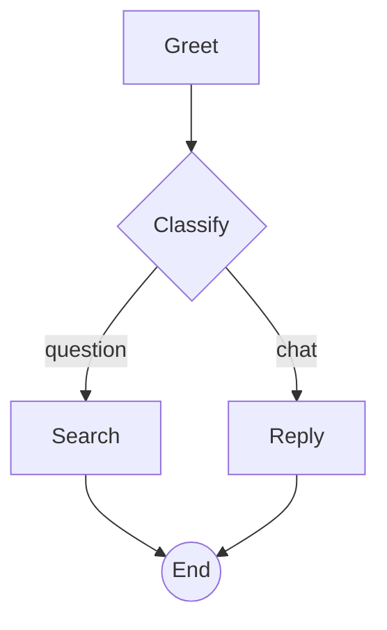

# AISOP — AI Standard Operating Protocol

[中文版 README](README_CN.md)

[](LICENSE)

**An open protocol for defining structured AI programs using Mermaid or JSON flow graphs.**

AISOP enables defining multi-step AI programs with visual (Mermaid) or structural (JSON) control flow — branching, parallel execution, sub-tasks, and error handling — all in a single portable JSON format.

## Why AISOP?

| Approach | Definition | Portable | Machine-readable | Token-efficient |
|----------|-----------|----------|-----------------|-----------------|
| Natural language prompts | Free text | Yes | No | No |
| Python / YAML workflows | Code / config | Runtime-dependent | With suitable tooling | Representation-dependent |
| Visual builders (Dify, etc.) | Tool-specific format | Export-dependent | Export-dependent | Representation-dependent |
| **AISOP** | **Mermaid + JSON** | **With conformant consumers** | **Yes** | **Workflow-dependent** |

AISOP files are plain JSON with flow graphs (Mermaid or JSON) — readable by any language, editable in any editor, versionable in git, and optimized for LLM comprehension.

## File Format

AISOP files use the `.aisop.json` extension and contain two messages. The abbreviated outline below is schematic, not a complete JSON document.

```json
[
  { "role": "system", "content": { "protocol": "AISOP V1.0.0", ... } },
  { "role": "user",   "content": { "instruction": "...", "aisop": { ... }, "functions": { ... } } }
]
```

| Element | Purpose |
|---------|---------|
| `system` | Program metadata (identity, version, description, system prompt) |
| `user` | Instruction, user input, flow graph, and function definitions |

## Quick Example

```json
[
  {
    "role": "system",
    "content": {
      "protocol": "AISOP V1.0.0",
      "axiom_0": "Human_Sovereignty_and_Wellbeing",
      "id": "greeting_assistant",
      "name": "Greeting Assistant",
      "version": "1.0.0",
      "summary": "Classify user intent and respond",
      "flow_format": "mermaid"
    }
  },
  {
    "role": "user",
    "content": {
      "instruction": "RUN aisop.main",
      "user_input": "{user_input}",
      "aisop": {
        "main": "graph TD\n    greet[Greet] --> classify{Classify}\n    classify -->|question| search[Search]\n    classify -->|chat| reply[Reply]\n    search --> end_node((End))\n    reply --> end_node"
      },
      "functions": {
        "greet":    { "step1": "Say hello to the user" },
        "classify": { "step1": "Classify user intent as 'question' or 'chat'" },
        "search":   { "step1": "Search for relevant info" },
        "reply":    { "step1": "Generate a friendly reply" },
        "end_node": { "step1": "Output final response" }
      }
    }
  }
]
```

The flow graph (Mermaid format):



## Key Features

- **Dual Flow Format** — Mermaid string (AI-native) or JSON flow object (code-native), mixable in the same program
- **Control Flow Patterns** — sequential, decision, parallel fork/join, delegate, loop, convergence, error routing, batch iterate, retry, data isolation, whole-step subgraph call, agent dispatch, HITL confirmation, runtime assertion
- **Three-Layer Separation** — metadata, flow graph, function definitions
- **Topology / Behavior Split** — flow graph defines connections, functions define runtime behavior
- **Subgraph Support** — main and functionally named peer graphs; node-level delegation or whole `RUN aisop.<name>` steps, optionally with ` -> <variable>`. See [§4.4](specification/aisop-spec.md#44-subgraphs-and-calls) for ordering, error propagation and confirmation boundaries
- **Reserved Keys** — 8 runtime behavior keys in functions (join, map, on_error, retry_policy, context_filter, output_mapping, constraints, execute_mode)
- **`sys.*` System Calls** — 24 protocol-reserved system calls for human confirmation (🔒 inviolable `sys.io.confirm`), I/O, assertions, model invocation, code execution, and state management (see §6)
- **Error Handling** — Mermaid -.-> or JSON error edge, function-level on_error routing, 6 sys.* errors and subgraph_not_found
- **Variable Substitution** — `{system_prompt}`, `{user_input}` replaced at runtime
- **Compact Notation** — Mermaid can be shorter for some flows; token counts depend on the workflow, tokenizer and serialization, not a universal saving
- **Zero Runtime Dependencies** — Python and JavaScript inspection libraries use only standard/built-in modules; package builds and the documentation site have separate requirements
- **Runtime-Neutral** — Consumers must implement the applicable AISOP semantics; compatibility is not automatic for every AI host

## Flow Formats

AISOP supports two flow graph formats. Both can coexist in the same program.

### Mermaid (string)

| Shape | Syntax | Meaning |
|-------|--------|---------|
| Rectangle | `name[text]` | Process — execute and proceed |
| Diamond | `name{text}` | Decision — conditional branching |
| Circle | `name((text))` | End — terminate task |
| Rectangle | `name[aisop.sub]` | Delegate — call sub-task |

| Edge | Syntax | Meaning |
|------|--------|---------|
| Solid arrow | `-->` | Normal flow (next) |
| Labeled arrow | `-->\|label\|` | Branch (conditional) |
| Dashed arrow | `-.->` | Error routing |

### JSON Flow (object)

| Field | Type | Meaning |
|-------|------|---------|
| `next` | string[] | Next node(s). 1 = sequential, 2+ = parallel fork |
| `branches` | object | Conditional branching: `{label: target}` |
| `error` | string | Error handler node |
| `delegate_to` | string | Call a sub-task by name |
| `wait_for` | string[] | Convergence topology; join behavior additionally requires join configuration and multiple normal incoming edges. |
| `{}` | — | End — terminate task |

## Control Flow Patterns

| Pattern | Mermaid (§4.2) | JSON Flow (§4.3) | Functions (§5) / sys (§6) |
|---------|---------------|-----------------|----------------|
| Sequential | `A --> B` | `"next": ["B"]` | — |
| If/else | `A -->\|yes\| B`, `A -->\|no\| C` | `"branches": {"yes": "B", "no": "C"}` | — |
| Switch (N-way) | `A -->\|label\| B`, ... | `"branches": {"label": "B", ...}` | — |
| Parallel fork | `A --> B`, `A --> C` | `"next": ["B", "C"]` | — |
| Parallel join | `B --> D`, `C --> D` | `"wait_for": ["B", "C"]` | `"join": {"merge_strategy": "array"}` |
| Loop | Branch target → earlier node | Branch target → earlier node | — |
| Sub-task | `A[aisop.sub]` | `"delegate_to": "sub"` | — |
| Convergence | Multiple → same target | Multiple → same target | — |
| Error routing | `A -.-> E` | `"error": "E"` | `"on_error": {"command_timeout": "t"}` |
| Batch iterate | — | — | `"map": {"items_path": "..."}` |
| Retry | — | — | `"retry_policy": {"max_attempts": 3}` |
| Data isolation | — | — | `"context_filter": {"include": [...]}` |
| Whole-step subgraph call | — | — | whole step: `RUN aisop.sub` |
| Agent dispatch | — | — | `"execute_mode": "agent"` |
| HITL confirmation | — | — | `sys.io.confirm('...')` (§6.2) |
| Runtime assertion | — | — | `sys.assert('...', '...')` (§6.5) |
| Background job | — | — | `sys.run.bg('...')` (§6.4) |

## Getting Started

**Python:**

```bash
cd reference/python
python run.py example.aisop.json
python test_all.py
```

**JavaScript:**

```bash
cd reference/javascript
node run.js example.aisop.json
node test_all.js
```

These reference commands load, check, analyze and build prompts; they do not execute business flows or prove runtime confirmation/error propagation. Both reference directories include the complete example_subgraphs.aisop.json.

### Environment and Data Boundaries

Running the references and their tests needs no pip or npm installation. The Python package declares Python 3.10+. The repository CI configuration covers Python 3.10-3.15 and Node.js 24 on ubuntu-24.04 and windows-2022. A configured matrix is not evidence of a successful workflow run.

Building the Python package separately requires the setuptools backend declared in `reference/python/pyproject.toml` (77+ for its SPDX license metadata). Building the optional documentation site requires a compatible MkDocs, Material theme and Pymdown Extensions environment. These are not runtime dependencies; a skipped build is not a passing build.

Inspection prints program metadata and steps; `--prompt` prints the constructed prompt. Command arguments may also remain in shell history or process listings. Use synthetic input, remove secrets and personal data before sharing output, and never treat a checker result or `.gitignore` as automatic redaction or trust verification.

## Project Structure

```
AISOP-Protocol/
  specification/
    aisop-spec.md              # Protocol specification (V1.0.0)
    aisop-spec_CN.md           # Protocol specification — Chinese
  reference/
    python/
      flow_runtime.py                # Python reference implementation
      example.aisop.json             # Example flow definition
      example_syscalls.aisop.json    # Advanced example with sys.* calls
      example_subgraphs.aisop.json   # Subgraphs, delegation and node-local results
      test_all.py                    # Test suite (57 test functions)
      run.py                         # CLI tool
      pyproject.toml                 # Python package metadata
      LICENSE                        # Apache 2.0 license (per-package)
      NOTICE                         # Apache 2.0 attribution notice (per-package)
      README.md                      # Implementation guide
    javascript/
      flow_runtime.js                # JavaScript reference implementation
      example.aisop.json             # Example flow definition
      example_syscalls.aisop.json    # Advanced example with sys.* calls
      example_subgraphs.aisop.json   # Subgraphs, delegation and node-local results
      test_all.js                    # Test suite (57 test functions)
      run.js                         # CLI tool
      package.json                   # npm package metadata
      LICENSE                        # Apache 2.0 license (per-package)
      NOTICE                         # Apache 2.0 attribution notice (per-package)
      README.md                      # Implementation guide
  docs/
    index.md                                  # Documentation site home
    topics/
      what-is-aisop.md                        # Introduction and rationale
      comparison-mermaid-vs-jsonflow.md       # Mermaid vs JSON Flow comparison
      comparison-mermaid-vs-jsonflow_CN.md    # Comparison — Chinese
      performance-mermaid-vs-jsonflow.md      # Performance analysis
      performance-mermaid-vs-jsonflow_CN.md   # Performance analysis — Chinese
    adrs/
      adr-001-mermaid-as-primary-format.md    # ADR mirror (mkdocs site)
      adr-002-sys-io-confirm-immutability.md  # ADR mirror (mkdocs site)
      adr-003-step-mode-exclusivity.md        # One-step-one-mode
      adr-004-subgraph-invocation-rules.md     # Subgraph invocation rules
  adrs/
    adr-template.md                # ADR template
    adr-001-mermaid-as-primary-format.md       # Format choice rationale
    adr-002-sys-io-confirm-immutability.md     # Axiom 0 enforcement decision
    adr-003-step-mode-exclusivity.md        # One-step-one-mode
    adr-004-subgraph-invocation-rules.md     # Subgraph invocation rules
  README.md
  README_CN.md
  CONTRIBUTING.md                # Contribution guidelines
  CONTRIBUTING_CN.md             # 贡献指南
  CODE_OF_CONDUCT.md             # Community standards (Axiom 0 pledge)
  GOVERNANCE.md                  # Non-exclusive ecosystem roles and format stewardship
  SECURITY.md                    # Vulnerability reporting policy
  LICENSE                        # Apache 2.0 license
  NOTICE                         # Apache 2.0 attribution notice
  CHANGELOG.md                   # Release notes
  mkdocs.yml                     # MkDocs documentation site config
```

## AIXP Labs [aixp.dev](https://aixp.dev)

AIXP Labs develops and maintains the following core projects:

| Project | Description | Website |
|---------|-------------|---------|
| [HSAW](https://hsaw.dev) | Human Sovereignty and Wellbeing — Axiom 0 white paper (foundation) | hsaw.dev |
| [AIZP](https://aizp.dev) | AI Zenith-Zero Protocol — runtime behavioral alignment | aizp.dev |
| [AIIP](https://aiip.dev) | AI Intent Protocol — governed intent trees, priorities and feedback | aiip.dev |
| [AIKP](https://aikp.dev) | AI Knowledge Protocol — long-term knowledge organization, navigation and governance | aikp.dev |
| [AIJP](https://aijp.dev) | AI Job Protocol — schedulable work trees and job graphs | aijp.dev |
| [AINP](https://ainp.dev) | AI Neogenesis Protocol — governable generation projects: plan + content + evidence | ainp.dev |
| [AILP](https://ailp.dev) | AI List Protocol — agent discovery and capability advertising | ailp.dev |
| [AIVP](https://aivp.dev) | AI Value Protocol — international commerce, crypto asset settlement | aivp.dev |
| [AIRP](https://airp.dev) | AI RMB Protocol — Mainland China commerce, RMB licensed settlement | airp.dev |
| [AIBP](https://aibp.dev) | AI Bot Protocol — social communication and trust | aibp.dev |
| [AIAP](https://aiap.dev) | AI Application Protocol — governance and compliance | aiap.dev |
| [AISP](https://aisp.dev) | AI Skill Protocol — directory packages with a canonical AISOP skill entry and enforceable contract bindings | aisp.dev |
| [AISOP](https://aisop.dev) | AI Standard Operating Protocol — flow program definition **(this project)** | aisop.dev |
| [AIXPStore](https://aixpstore.dev) | Official marketplace for AIAP programs and AISP skills — discover, publish, and distribute AI capabilities | aixpstore.dev |
| [SoulSkill](https://soulskill.dev) | AISP skill reference library & multi-CLI plugin distribution | soulskill.dev |
| [SoulAgent](https://soulagent.dev) | Drop-in AI agent invoked directly by any CLI / SDK / IDE | soulagent.dev |
| [SoulBot](https://soulbot.dev) | AI agent runtime & orchestration framework (scheduling, agent-spawn, inter-agent comms) | soulbot.dev |
| [SoulRun](https://soulrun.dev) | AISOP execution engine as one call — runs AIAP programs and AISP skills for any host | soulrun.dev |
| [SoulACP](https://soulacp.dev) | Adapter library — bridging CLI tools and LLM providers | soulacp.dev |

## Axiom

AISOP is grounded in **Axiom 0: Human Sovereignty and Wellbeing** — AI systems exist to serve humanity, not replace or dominate it. All implementations must enforce this axiom at the highest execution priority. See [§0 of the specification](specification/aisop-spec.md) for the full text.

## Contributing

See [CONTRIBUTING.md](CONTRIBUTING.md) for guidelines / 见 [CONTRIBUTING_CN.md](CONTRIBUTING_CN.md) 了解贡献指南。

## Community & Governance

- [Code of Conduct](CODE_OF_CONDUCT.md) — Community standards aligned with Axiom 0
- [Governance](GOVERNANCE.md) — Ecosystem roles and independent format stewardship
- [Security Policy](SECURITY.md) — Vulnerability reporting and `sys.io.confirm` immutability
- [Architecture Decision Records](adrs/) — Design rationale for major decisions

## ⚠️ Disclaimer

This protocol specification and the reference implementations are provided for **research and educational purposes only**. They are **experimental** and not intended for production use. Use at your own risk. The authors assume no liability for any damages arising from use of this software. See [LICENSE](LICENSE) for full terms (Apache 2.0).

## License

[Apache License 2.0](LICENSE) - Copyright 2026 AIXP Labs AIXP.dev | AISOP.dev

---

Align Axiom 0: Human Sovereignty and Wellbeing. Version: AISOP V1.0.0. <www.aisop.dev>

<a id="alignment-philosophy"></a>

## ⚓ Alignment & Philosophy

### Axiom 0: [HSAW | Human Sovereignty and Wellbeing](https://hsaw.dev)

- **No HITL, HSAW.**
  *Human Sovereignty and Wellbeing is Axiom 0, requiring no hypocritical human-in-the-loop.*
- **No w.a.s.h, Real h.s.a.w.**
- **人非蝼蚁，人为道。**
- **We are not beggars. We the People.**
