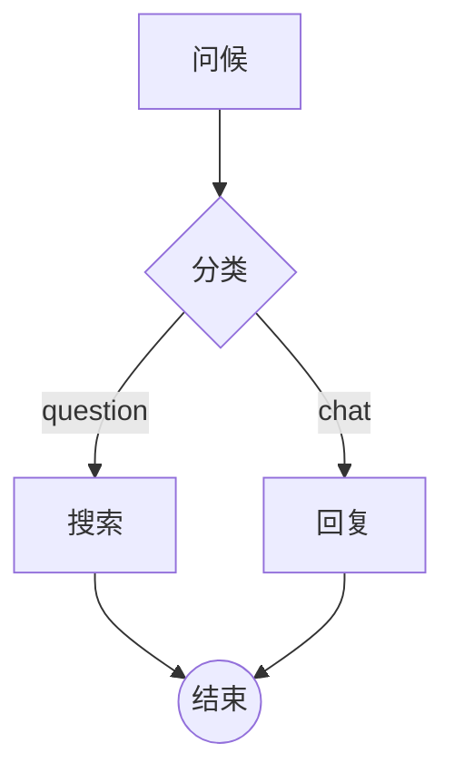

# AISOP — AI 标准作业协议

[English README](README.md)

[](LICENSE)

**用 Mermaid 或 JSON Flow 流程图定义结构化 AI 程序的开放协议。**

AISOP 使用 Mermaid 或 JSON Flow 流程图定义多步骤 AI 程序 — 支持分支、并行执行、子任务和错误处理 — 全部在一个可移植的 JSON 格式中。

## 为什么选择 AISOP？

| 方案 | 定义方式 | 可移植 | 机器可读 | Token 高效 |
|------|---------|--------|---------|-----------|
| 自然语言提示 | 自由文本 | 是 | 否 | 否 |
| Python / YAML 工作流 | 代码 / 配置 | 取决于运行时 | 需要合适工具 | 取决于表示方式 |
| 可视化构建器 (Dify 等) | 工具特定格式 | 取决于导出能力 | 取决于导出能力 | 取决于表示方式 |
| **AISOP** | **Mermaid + JSON** | **需要合规消费方** | **是** | **取决于流程** |

AISOP 文件是包含流程图（Mermaid 或 JSON Flow）的纯 JSON — 任何语言可读、任何编辑器可编辑、可用 git 版本管理，且为 LLM 理解而优化。

## 文件格式

AISOP 文件使用 `.aisop.json` 扩展名，由两条消息组成。以下省略式结构仅作示意，不是完整的 JSON 文档。

```json
[
  { "role": "system", "content": { "protocol": "AISOP V1.0.0", ... } },
  { "role": "user",   "content": { "instruction": "...", "aisop": { ... }, "functions": { ... } } }
]
```

| 元素 | 用途 |
|------|------|
| `system` | 程序元数据（身份、版本、描述、系统提示） |
| `user` | 指令、用户输入、流程图、函数定义 |

## 快速示例

```json
[
  {
    "role": "system",
    "content": {
      "protocol": "AISOP V1.0.0",
      "axiom_0": "Human_Sovereignty_and_Wellbeing",
      "id": "greeting_assistant",
      "name": "问候助手",
      "version": "1.0.0",
      "summary": "分类用户意图并回复",
      "flow_format": "mermaid"
    }
  },
  {
    "role": "user",
    "content": {
      "instruction": "RUN aisop.main",
      "user_input": "{user_input}",
      "aisop": {
        "main": "graph TD\n    greet[问候] --> classify{分类}\n    classify -->|question| search[搜索]\n    classify -->|chat| reply[回复]\n    search --> end_node((结束))\n    reply --> end_node"
      },
      "functions": {
        "greet":    { "step1": "向用户问好并了解需求" },
        "classify": { "step1": "判断用户意图是 question 还是 chat" },
        "search":   { "step1": "搜索相关信息并回答" },
        "reply":    { "step1": "生成友好的对话回复" },
        "end_node": { "step1": "输出最终回复给用户" }
      }
    }
  }
]
```

流程图（Mermaid 格式）：



## 核心特性

- **双流图格式** — Mermaid 字符串（AI 原生）或 JSON flow 对象（代码原生），可在同一程序中混用
- **控制流模式** — 顺序、决策、并行分叉/汇聚、委派、回环、收敛、错误路由、批量迭代、重试、数据隔离、整步子图调用、Agent 派发、真人确认、运行时断言
- **三层分离** — 元数据、流程图、函数定义
- **拓扑/行为分离** — 流程图定义连接，函数定义运行时行为
- **子图支持** — main 与功能命名子图并列；使用节点级委派或整步 `RUN aisop.<name>`，可带 ` -> <variable>`。顺序、错误回传与确认边界见[规范§4.4](specification/aisop-spec_CN.md#44-子图与调用)
- **保留键** — 函数中 8 个运行时行为键（join, map, on_error, retry_policy, context_filter, output_mapping, constraints, execute_mode）
- **`sys.*` 系统调用** — 24项协议保留调用，涵盖真人确认（不可绕过的sys.io.confirm）、I/O、断言、模型调用、代码执行与状态管理（见§6）
- **错误处理** — Mermaid `-.->` 或 JSON error 错误边、函数层 on_error 类型路由、6项sys错误及subgraph_not_found
- **变量替换** — `{system_prompt}`、`{user_input}` 在运行时替换
- **紧凑表示** — Mermaid 在某些流程中可能更短；token 数取决于流程、tokenizer 和序列化方式，不承诺普遍节省比例
- **运行时零依赖** — Python 和 JavaScript 检查库仅使用标准库或内置模块；包构建和文档站有独立要求
- **运行时中立** — 消费方必须实现适用的 AISOP 语义，不代表任意 AI 宿主都自动兼容

## 流图格式

AISOP 支持两种流图格式，可在同一程序中共存。

### Mermaid（字符串）

| 形状 | 语法 | 含义 |
|------|------|------|
| 矩形 | `name[text]` | 处理 — 执行后继续 |
| 菱形 | `name{text}` | 决策 — 条件分支 |
| 圆形 | `name((text))` | 结束 — 终止任务 |
| 矩形 | `name[aisop.sub]` | 委派 — 调用子任务 |

| 边 | 语法 | 含义 |
|----|------|------|
| 实线箭头 | `-->` | 正常流程（下一步） |
| 标签箭头 | `-->\|label\|` | 分支（条件） |
| 虚线箭头 | `-.->` | 错误路由 |

### JSON Flow（对象）

| 字段 | 类型 | 含义 |
|------|------|------|
| `next` | string[] | 下一个节点。1 个 = 顺序，2+ = 并行分叉 |
| `branches` | object | 条件分支：`{标签: 目标}` |
| `error` | string | 错误处理节点 |
| `delegate_to` | string | 调用子任务 |
| `wait_for` | string[] | 表示汇聚拓扑；join 行为还要求 join 配置和多条正常入边。 |
| `{}` | — | 结束 — 终止任务 |

## 控制流模式

| 模式 | Mermaid（§4.2） | JSON Flow（§4.3） | 函数（§5） / sys（§6） |
|------|----------------|------------------|-----------|
| 顺序 | `A --> B` | `"next": ["B"]` | — |
| 二分支 | `A -->\|yes\| B`, `A -->\|no\| C` | `"branches": {"yes": "B", "no": "C"}` | — |
| 多分支 | `A -->\|label\| B`, ... | `"branches": {"label": "B", ...}` | — |
| 并行分叉 | `A --> B`, `A --> C` | `"next": ["B", "C"]` | — |
| 并行汇聚 | `B --> D`, `C --> D` | `"wait_for": ["B", "C"]` | `"join": {"merge_strategy": "array"}` |
| 回环 | 分支目标 → 较早节点 | 分支目标 → 较早节点 | — |
| 子任务 | `A[aisop.sub]` | `"delegate_to": "sub"` | — |
| 收敛 | 多个 → 同一目标 | 多个 → 同一目标 | — |
| 错误路由 | `A -.-> E` | `"error": "E"` | `"on_error": {"command_timeout": "t"}` |
| 批量迭代 | — | — | `"map": {"items_path": "..."}` |
| 重试 | — | — | `"retry_policy": {"max_attempts": 3}` |
| 数据隔离 | — | — | `"context_filter": {"include": [...]}` |
| 整步子图调用 | — | — | 独占整步：`RUN aisop.sub` |
| Agent 派发 | — | — | `"execute_mode": "agent"` |
| HITL 确认 | — | — | `sys.io.confirm('...')` (§6.2) |
| 运行时断言 | — | — | `sys.assert('...', '...')` (§6.5) |
| 后台任务 | — | — | `sys.run.bg('...')` (§6.4) |

## 快速开始

**Python：**

```bash
cd reference/python
python run.py example.aisop.json
python test_all.py
```

**JavaScript：**

```bash
cd reference/javascript
node run.js example.aisop.json
node test_all.js
```

上述参考命令只加载、检查、分析并构造prompt，不执行业务流程，也不能证明真人门或错误回传已在运行时落实。完整子图例见两个参考目录的example_subgraphs.aisop.json。

### 环境与数据边界

运行参考库和原测试不需要 pip 或 npm 安装。Python 包声明支持 Python 3.10+。仓库 CI 配置覆盖 Python 3.10～3.15、Node.js 24 以及 ubuntu-24.04 和 windows-2022。配置了矩阵不代表某次工作流已经运行成功。

单独构建 Python 包需要 `reference/python/pyproject.toml` 声明的 setuptools 后端（SPDX 许可证元数据要求 77+）。构建可选文档站需要兼容的 MkDocs、Material 主题和 Pymdown Extensions 环境。它们不是运行依赖；未构建不能记为构建通过。

检查命令会输出程序元数据和步骤，`--prompt` 会输出构造后的完整 prompt；命令参数还可能留在 shell 历史或进程列表中。请使用合成输入，分享输出前移除秘密和个人信息，不能把检查通过或 `.gitignore` 当作自动脱敏或信任核验。

## 项目结构

```
AISOP-Protocol/
  specification/
    aisop-spec.md              # 协议规范 (V1.0.0)
    aisop-spec_CN.md           # 协议规范 — 中文版
  reference/
    python/
      flow_runtime.py                # Python 参考实现
      example.aisop.json             # 示例流程定义
      example_syscalls.aisop.json    # 高级示例（sys.* 调用）
      example_subgraphs.aisop.json   # 子图、委派及节点局部结果
      test_all.py                    # 测试套件（57个测试函数）
      run.py                         # 命令行工具
      pyproject.toml                 # Python 包元数据
      LICENSE                        # Apache 2.0 许可证（包内副本）
      NOTICE                         # Apache 2.0 归属声明（包内副本）
      README.md                      # 实现说明
    javascript/
      flow_runtime.js                # JavaScript 参考实现
      example.aisop.json             # 示例流程定义
      example_syscalls.aisop.json    # 高级示例（sys.* 调用）
      example_subgraphs.aisop.json   # 子图、委派及节点局部结果
      test_all.js                    # 测试套件（57个测试函数）
      run.js                         # 命令行工具
      package.json                   # npm 包元数据
      LICENSE                        # Apache 2.0 许可证（包内副本）
      NOTICE                         # Apache 2.0 归属声明（包内副本）
      README.md                      # 实现说明
  docs/
    index.md                                  # 文档站首页
    topics/
      what-is-aisop.md                        # 介绍与背景
      comparison-mermaid-vs-jsonflow.md       # Mermaid vs JSON Flow 对比
      comparison-mermaid-vs-jsonflow_CN.md    # 对比 — 中文版
      performance-mermaid-vs-jsonflow.md      # 性能分析
      performance-mermaid-vs-jsonflow_CN.md   # 性能分析 — 中文版
    adrs/
      adr-001-mermaid-as-primary-format.md    # ADR 镜像（mkdocs 站点用）
      adr-002-sys-io-confirm-immutability.md  # ADR 镜像（mkdocs 站点用）
      adr-003-step-mode-exclusivity.md        # 一步一模式
      adr-004-subgraph-invocation-rules.md     # 子图调用规则
  adrs/
    adr-template.md                # ADR 模板
    adr-001-mermaid-as-primary-format.md       # 格式选择决策
    adr-002-sys-io-confirm-immutability.md     # Axiom 0 执行层保证决策
    adr-003-step-mode-exclusivity.md        # 一步一模式
    adr-004-subgraph-invocation-rules.md     # 子图调用规则
  README.md
  README_CN.md
  CONTRIBUTING.md                # 英文贡献指南
  CONTRIBUTING_CN.md             # 中文贡献指南
  CODE_OF_CONDUCT.md             # 行为准则（公理 0 承诺）
  GOVERNANCE.md                  # 非独占生态分工与格式维护
  SECURITY.md                    # 安全漏洞报告政策
  LICENSE                        # Apache 2.0 许可证
  NOTICE                         # Apache 2.0 归属声明
  CHANGELOG.md                   # 版本历史
  mkdocs.yml                     # MkDocs 文档站点配置
```

## AIXP Labs [aixp.dev](https://aixp.dev)

AIXP Labs 开发和维护以下核心项目：

| 项目 | 描述 | 网站 |
|------|------|------|
| [HSAW](https://hsaw.dev) | 人类主权与福祉 —— Axiom 0 白皮书（基石） | hsaw.dev |
| [AIZP](https://aizp.dev) | AI Zenith-Zero Protocol —— 运行时行为对齐 | aizp.dev |
| [AIIP](https://aiip.dev) | AI Intent Protocol（AI 意图协议）—— 意图树治理、优先级与反馈 | aiip.dev |
| [AIKP](https://aikp.dev) | AI Knowledge Protocol（AI 知识协议）—— 长期知识组织、导航与治理 | aikp.dev |
| [AIJP](https://aijp.dev) | AI Job Protocol（AI 作业协议）—— 可调度的工作树与作业图 | aijp.dev |
| [AINP](https://ainp.dev) | AI Neogenesis Protocol（AI 创生协议）—— 可治理的生成项目：计划 + 内容 + 证据 | ainp.dev |
| [AILP](https://ailp.dev) | AI List Protocol —— agent 发现与能力广告 | ailp.dev |
| [AIVP](https://aivp.dev) | AI Value Protocol —— 国际商务、加密资产结算 | aivp.dev |
| [AIRP](https://airp.dev) | AI RMB Protocol —— 中国大陆商务、人民币持牌结算 | airp.dev |
| [AIBP](https://aibp.dev) | AI Bot Protocol —— 社交通信与信任 | aibp.dev |
| [AIAP](https://aiap.dev) | AI Application Protocol —— 治理与合规 | aiap.dev |
| [AISP](https://aisp.dev) | AI Skill Protocol —— 目录式技能包，以 AISOP 技能入口和可执行契约绑定为核心 | aisp.dev |
| [AISOP](https://aisop.dev) | AI Standard Operating Protocol —— 流程程序定义 **（本项目）** | aisop.dev |
| [AIXPStore](https://aixpstore.dev) | AIAP 程序与 AISP 技能官方市场 —— 发现、发布和分发 AI 能力包 | aixpstore.dev |
| [SoulSkill](https://soulskill.dev) | AISP 技能参考库 & 多 CLI 插件分发 | soulskill.dev |
| [SoulAgent](https://soulagent.dev) | 任何 CLI / SDK / IDE 直接调用的 drop-in AI agent | soulagent.dev |
| [SoulBot](https://soulbot.dev) | AI agent 运行时 & 自编排框架（定时、建 agent、agent 间通信） | soulbot.dev |
| [SoulRun](https://soulrun.dev) | 一个调用的 AISOP 执行引擎 —— 为任何宿主运行 AIAP 程序与 AISP 技能 | soulrun.dev |
| [SoulACP](https://soulacp.dev) | 适配库 —— 桥接 CLI 工具与 LLM 提供方 | soulacp.dev |

## 公理

AISOP 以**公理 0：人类主权与福祉**为基础 — AI 系统服务于人类，而非取代或支配人类。所有实现必须将此公理置于执行优先级的最高层。完整内容见[规范 §0](specification/aisop-spec_CN.md)。

## 贡献

见 [CONTRIBUTING_CN.md](CONTRIBUTING_CN.md) 了解贡献指南 / See [CONTRIBUTING.md](CONTRIBUTING.md) for English guidelines.

## 社区与治理

- [行为准则](CODE_OF_CONDUCT.md) — 与公理 0 对齐的社区标准
- [治理](GOVERNANCE.md) — 生态分工与协议自主维护
- [安全政策](SECURITY.md) — 漏洞报告与 `sys.io.confirm` 不可绕过性
- [架构决策记录](adrs/) — 重大设计决策的论证

## ⚠️ 免责声明

本协议规范及参考实现仅供**研究和教育用途**。**实验性**软件，不适用于生产环境。使用风险由用户自行承担。作者对因使用本软件造成的任何损害不承担责任。完整条款见 [LICENSE](LICENSE)（Apache 2.0）。

## 许可证

[Apache License 2.0](LICENSE) - Copyright 2026 AIXP Labs AIXP.dev | AISOP.dev

---

Align Axiom 0: Human Sovereignty and Wellbeing. Version: AISOP V1.0.0. <www.aisop.dev>

<a id="values-philosophy"></a>

## ⚓ 价值观与哲学 (Alignment & Philosophy)

### Axiom 0: [HSAW | Human Sovereignty and Wellbeing](https://hsaw.dev)

- **No HITL, HSAW.**
  *人类主权与福祉是第零公理，无需虚伪的人机协同。*
- **No w.a.s.h, Real h.s.a.w.**
- **人非蝼蚁，人为道。**
- **We are not beggars. We the People.**
