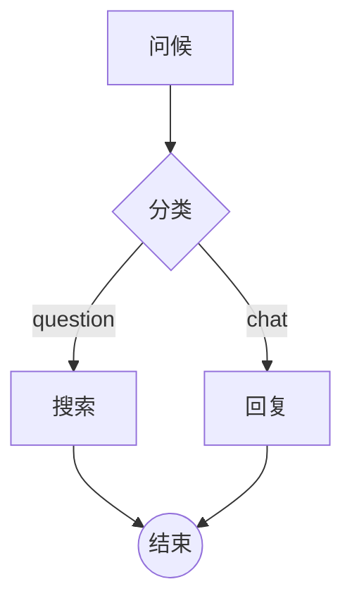

# AISOP — AI 标准作业协议

[English README](README.md)

[](LICENSE)

**用 Mermaid 或 JSON Flow 流程图定义结构化 AI 程序的开放协议。**

AISOP 使用 Mermaid 或 JSON Flow 流程图定义多步骤 AI 程序 — 支持分支、并行执行、子任务和错误处理 — 全部在一个可移植的 JSON 格式中。

## 为什么选择 AISOP？

| 方案 | 定义方式 | 可移植 | 机器可读 | Token 高效 |
|------|---------|--------|---------|-----------|
| 自然语言提示 | 自由文本 | 是 | 否 | 否 |
| Python / YAML 工作流 | 代码 / 配置 | 否 | 部分 | 否 |
| 可视化构建器 (Dify 等) | 专有格式 | 否 | 否 | 否 |
| **AISOP** | **Mermaid + JSON** | **是** | **是** | **是** |

AISOP 文件是包含流程图（Mermaid 或 JSON Flow）的纯 JSON — 任何语言可读、任何编辑器可编辑、可用 git 版本管理，且为 LLM 理解而优化。

## 文件格式

AISOP 文件使用 `.aisop.json` 扩展名，由两个元素组成的 JSON 数组：

```json
[
  { "role": "system", "content": { "protocol": "AISOP V1.0.0", ... } },
  { "role": "user",   "content": { "instruction": "...", "aisop": { ... }, "functions": { ... } } }
]
```

| 元素 | 用途 |
|------|------|
| `system` | 程序元数据（身份、版本、描述、系统提示） |
| `user` | 指令、用户输入、流程图、函数定义 |

## 快速示例

```json
[
  {
    "role": "system",
    "content": {
      "protocol": "AISOP V1.0.0",
      "axiom_0": "Human_Sovereignty_and_Wellbeing",
      "id": "greeting_assistant",
      "name": "问候助手",
      "version": "1.0.0",
      "summary": "分类用户意图并回复",
      "flow_format": "mermaid"
    }
  },
  {
    "role": "user",
    "content": {
      "instruction": "RUN aisop.main",
      "user_input": "{user_input}",
      "aisop": {
        "main": "graph TD\n    greet[问候] --> classify{分类}\n    classify -->|question| search[搜索]\n    classify -->|chat| reply[回复]\n    search --> end_node((结束))\n    reply --> end_node"
      },
      "functions": {
        "greet":    { "step1": "向用户问好并了解需求" },
        "classify": { "step1": "判断用户意图是 question 还是 chat" },
        "search":   { "step1": "搜索相关信息并回答" },
        "reply":    { "step1": "生成友好的对话回复" },
        "end_node": { "step1": "输出最终回复给用户" }
      }
    }
  }
]
```

流程图（Mermaid 格式）：



## 核心特性

- **双流图格式** — Mermaid 字符串（AI 原生）或 JSON flow 对象（代码原生），可在同一程序中混用
- **14 种控制流模式** — 顺序、决策、并行分叉/汇聚、委派、回环、收敛、错误路由、批量迭代、重试、数据隔离、步骤内子流程、Agent 派发
- **三层分离** — 元数据、流程图、函数定义
- **拓扑/行为分离** — 流程图定义连接，函数定义运行时行为
- **子任务支持** — `main` + 命名子任务，通过委派节点或步骤层 `RUN aisop.<sub>` 调用
- **保留键** — 函数中 8 个运行时行为键（join, map, on_error, retry_policy, context_filter, output_mapping, constraints, execute_mode）
- **错误处理** — Mermaid `-.->` 错误边 + 函数层 `on_error` 类型路由
- **变量替换** — `{system_prompt}`、`{user_input}` 在运行时替换
- **Token 高效** — Mermaid 格式比 JSON flow 格式少约 50% token
- **零依赖** — Python 和 JavaScript 参考实现，仅使用标准库
- **AI 无关** — 可与任何 AI 运行时配合使用

## 流图格式

AISOP 支持两种流图格式，可在同一程序中共存。

### Mermaid（字符串）

| 形状 | 语法 | 含义 |
|------|------|------|
| 矩形 | `name[text]` | 处理 — 执行后继续 |
| 菱形 | `name{text}` | 决策 — 条件分支 |
| 圆形 | `name((text))` | 结束 — 终止任务 |
| 矩形 | `name[aisop.sub]` | 委派 — 调用子任务 |

| 边 | 语法 | 含义 |
|----|------|------|
| 实线箭头 | `-->` | 正常流程（下一步） |
| 标签箭头 | `-->\|label\|` | 分支（条件） |
| 虚线箭头 | `-.->` | 错误路由 |

### JSON Flow（对象）

| 字段 | 类型 | 含义 |
|------|------|------|
| `next` | string[] | 下一个节点。1 个 = 顺序，2+ = 并行分叉 |
| `branches` | object | 条件分支：`{标签: 目标}` |
| `error` | string | 错误处理节点 |
| `delegate_to` | string | 调用子任务 |
| `wait_for` | string[] | 等待节点完成后继续（汇聚） |
| `{}` | — | 结束 — 终止任务 |

## 控制流模式

| 模式 | Mermaid（§4.2） | JSON Flow（§4.3） | 函数（§5） / sys（§6） |
|------|----------------|------------------|-----------|
| 顺序 | `A --> B` | `"next": ["B"]` | — |
| 二分支 | `A -->\|yes\| B`, `A -->\|no\| C` | `"branches": {"yes": "B", "no": "C"}` | — |
| 多分支 | `A -->\|label\| B`, ... | `"branches": {"label": "B", ...}` | — |
| 并行分叉 | `A --> B`, `A --> C` | `"next": ["B", "C"]` | — |
| 并行汇聚 | `B --> D`, `C --> D` | `"wait_for": ["B", "C"]` | `"join": {"merge_strategy": "array"}` |
| 回环 | 分支目标 → 较早节点 | 分支目标 → 较早节点 | — |
| 子任务 | `A[aisop.sub]` | `"delegate_to": "sub"` | — |
| 收敛 | 多个 → 同一目标 | 多个 → 同一目标 | — |
| 错误路由 | `A -.-> E` | `"error": "E"` | `"on_error": {"timeout": "t"}` |
| 批量迭代 | — | — | `"map": {"items_path": "..."}` |
| 重试 | — | — | `"retry_policy": {"max_attempts": 3}` |
| 数据隔离 | — | — | `"context_filter": {"include": [...]}` |
| 步骤内子流程 | — | — | step 中写 `RUN aisop.sub` |
| Agent 派发 | — | — | `"execute_mode": "agent"` |
| HITL 确认 | — | — | `sys.io.confirm('...')` (§6.2) |
| 运行时断言 | — | — | `sys.assert('...', '...')` (§6.5) |
| 后台任务 | — | — | `sys.run.bg('...')` (§6.4) |

## 快速开始

**Python：**
```bash
cd reference/python
python run.py example.aisop.json
python test_all.py
```

**JavaScript：**
```bash
cd reference/javascript
node run.js example.aisop.json
node test_all.js
```

## 项目结构

```
AISOP-Protocol/
  specification/
    aisop-spec.md              # 协议规范 (V1.0.0)
    aisop-spec_CN.md           # 协议规范 — 中文版
  reference/
    python/
      flow_runtime.py                # Python 参考实现
      example.aisop.json             # 示例流程定义
      example_syscalls.aisop.json    # 高级示例（sys.* 调用）
      test_all.py                    # 测试套件（44 个测试）
      run.py                         # 命令行工具
      pyproject.toml                 # Python 包元数据
      LICENSE                        # Apache 2.0 许可证（包内副本）
      NOTICE                         # Apache 2.0 归属声明（包内副本）
      README.md                      # 实现说明
    javascript/
      flow_runtime.js                # JavaScript 参考实现
      example.aisop.json             # 示例流程定义
      example_syscalls.aisop.json    # 高级示例（sys.* 调用）
      test_all.js                    # 测试套件（44 个测试）
      run.js                         # 命令行工具
      package.json                   # npm 包元数据
      LICENSE                        # Apache 2.0 许可证（包内副本）
      NOTICE                         # Apache 2.0 归属声明（包内副本）
      README.md                      # 实现说明
  docs/
    index.md                                  # 文档站首页
    topics/
      what-is-aisop.md                        # 介绍与背景
      comparison-mermaid-vs-jsonflow.md       # Mermaid vs JSON Flow 对比
      comparison-mermaid-vs-jsonflow_CN.md    # 对比 — 中文版
      performance-mermaid-vs-jsonflow.md      # 性能分析
      performance-mermaid-vs-jsonflow_CN.md   # 性能分析 — 中文版
    adrs/
      adr-001-mermaid-as-primary-format.md    # ADR 镜像（mkdocs 站点用）
      adr-002-sys-io-confirm-immutability.md  # ADR 镜像（mkdocs 站点用）
  adrs/
    adr-template.md                # ADR 模板
    adr-001-mermaid-as-primary-format.md       # 格式选择决策
    adr-002-sys-io-confirm-immutability.md     # Axiom 0 执行层保证决策
  README.md
  README_CN.md
  CONTRIBUTING.md                # 英文贡献指南
  CONTRIBUTING_CN.md             # 中文贡献指南
  CODE_OF_CONDUCT.md             # 行为准则（公理 0 承诺）
  GOVERNANCE.md                  # 三方治理模型
  SECURITY.md                    # 安全漏洞报告政策
  LICENSE                        # Apache 2.0 许可证
  NOTICE                         # Apache 2.0 归属声明
  CHANGELOG.md                   # 版本历史
  mkdocs.yml                     # MkDocs 文档站点配置
```

## AIXP Labs [aixp.dev](https://aixp.dev)

AIXP Labs 开发和维护以下核心项目：

| 项目 | 描述 | 网站 |
|------|------|------|
| [HSAW](https://hsaw.dev) | 人类主权与福祉 — 公理 0 白皮书（基座） | hsaw.dev |
| [AILP](https://ailp.dev) | AI List Protocol — 代理发现与能力广告 | ailp.dev |
| [AIVP](https://aivp.dev) | AI Value Protocol — 国际商业、加密资产结算 | aivp.dev |
| [AIRP](https://airp.dev) | AI RMB Protocol — 中国大陆商业、人民币持牌结算 | airp.dev |
| [AIBP](https://aibp.dev) | AI Bot Protocol — 社交通信与信任 | aibp.dev |
| [AIAP](https://aiap.dev) | AI Application Protocol — 治理与合规 | aiap.dev |
| [AISOP](https://aisop.dev) | AI Standard Operating Protocol — 流程程序定义（本项目） | aisop.dev |
| [SoulBot](https://soulbot.dev) | AI 代理运行时与框架 | soulbot.dev |
| [SoulACP](https://soulacp.dev) | 适配器库 — 桥接 CLI 工具与 LLM 提供商 | soulacp.dev |

## 公理

AISOP 以**公理 0：人类主权与福祉**为基础 — AI 系统服务于人类，而非取代或支配人类。所有实现必须将此公理置于执行优先级的最高层。完整内容见[规范 §0](specification/aisop-spec_CN.md)。

## 贡献

见 [CONTRIBUTING_CN.md](CONTRIBUTING_CN.md) 了解贡献指南 / See [CONTRIBUTING.md](CONTRIBUTING.md) for English guidelines.

## 社区与治理

- [行为准则](CODE_OF_CONDUCT.md) — 与公理 0 对齐的社区标准
- [治理](GOVERNANCE.md) — 三方治理模型（Seed / Authority / Executor）
- [安全政策](SECURITY.md) — 漏洞报告与 `sys.io.confirm` 不可绕过性
- [架构决策记录](adrs/) — 重大设计决策的论证

## ⚠️ 免责声明

本协议规范及参考实现仅供**研究和教育用途**。**实验性**软件，不适用于生产环境。使用风险由用户自行承担。作者对因使用本软件造成的任何损害不承担责任。完整条款见 [LICENSE](LICENSE)（Apache 2.0）。

## 许可证

[Apache License 2.0](LICENSE) - Copyright 2026 AIXP Labs AIXP.dev | AISOP.dev

---

Align Axiom 0: Human Sovereignty and Wellbeing. Version: AISOP V1.0.0. www.aisop.dev
