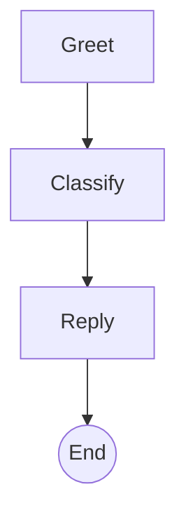
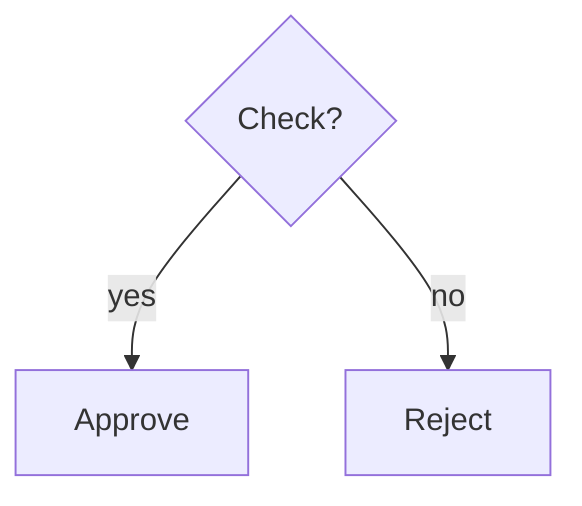
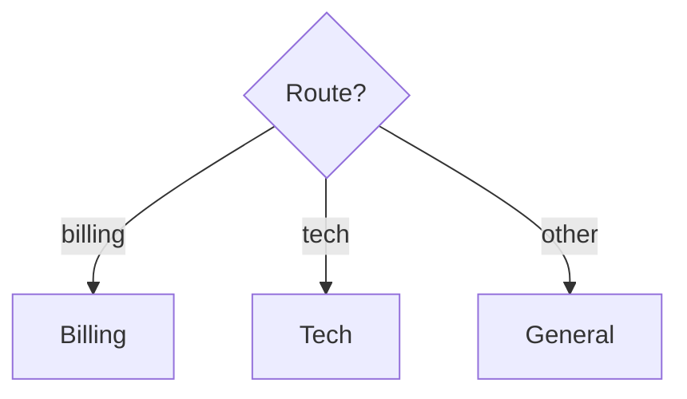
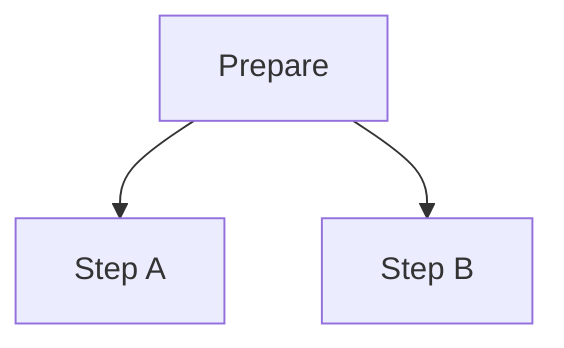
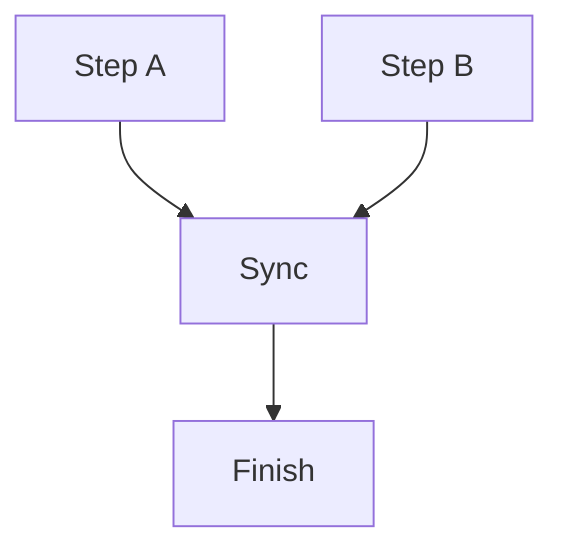
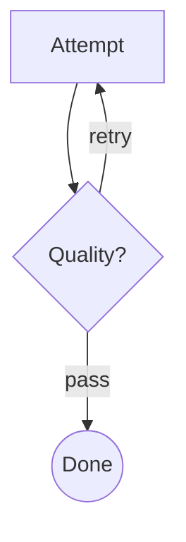
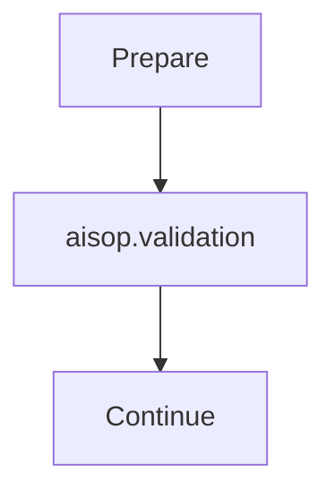
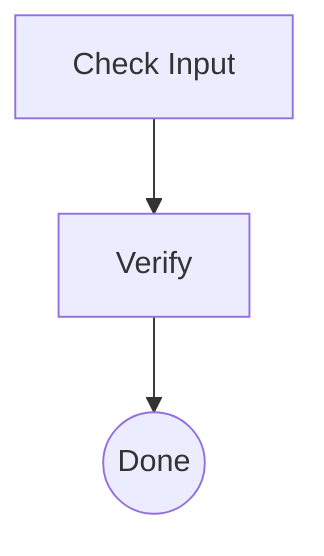
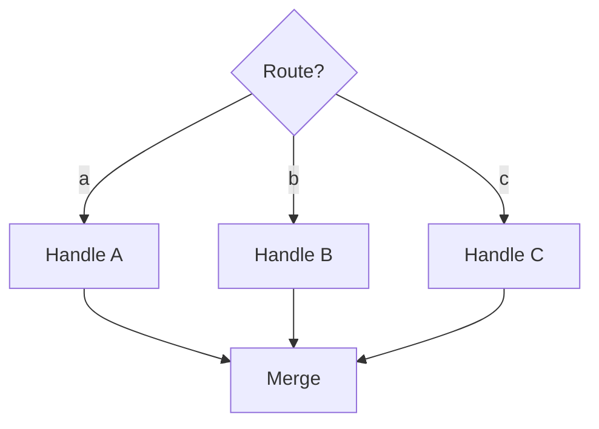
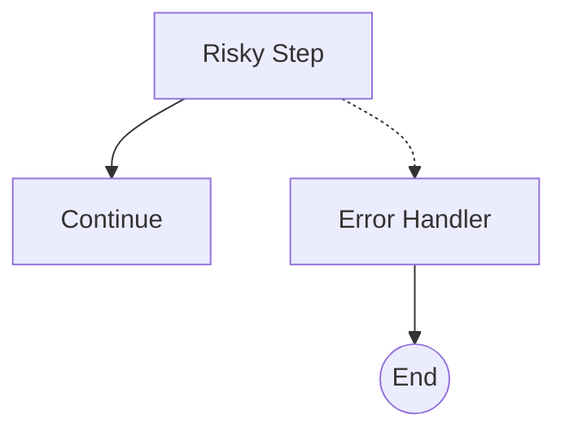

# Mermaid vs JSON Flow: Control Flow Comparison

## Overview

| Control Structure | Mermaid | JSON Flow | Notes |
|-------------------|---------|-----------|-------|
| Sequential | Supported | Supported | Equivalent |
| If/else | Supported | Supported | Equivalent |
| Switch (N-way) | Supported | Supported | Equivalent |
| Parallel fork | Supported | Supported | Equivalent |
| Parallel join | Supported | Supported | JSON Flow more explicit |
| Loop | Supported | Supported | Equivalent |
| Sub-task | Supported | Supported | JSON Flow has `delegate_to` |
| Convergence | Supported | Supported | Equivalent |
| Error routing | Supported | Supported | Both have native error edges |

---

## Side-by-Side

### 1. Sequential

**Mermaid:**


**JSON Flow:**
```json
{
  "greet":    { "next": ["classify"] },
  "classify": { "next": ["reply"] },
  "reply":    { "next": ["end"] },
  "end":      {}
}
```

---

### 2. If/else

**Mermaid:**


**JSON Flow:**
```json
{
  "check": { "branches": { "yes": "approve", "no": "reject" } }
}
```

---

### 3. Switch (N-way)

**Mermaid:**


**JSON Flow:**
```json
{
  "route": {
    "branches": { "billing": "billing", "tech": "tech", "other": "general" }
  }
}
```

---

### 4. Parallel Fork

**Mermaid:**


**JSON Flow:**
```json
{
  "prepare": { "next": ["step_a", "step_b"] }
}
```

---

### 5. Parallel Join

**Mermaid:**


**JSON Flow:**
```json
{
  "step_a": { "next": ["sync"] },
  "step_b": { "next": ["sync"] },
  "sync":   { "wait_for": ["step_a", "step_b"], "next": ["finish"] }
}
```

JSON Flow advantage: `wait_for` explicitly declares which nodes to wait for. In Mermaid, the visual convergence implies join behavior, but the explicit wait list is not available — join semantics come from the `join` key in functions.

---

### 6. Loop

**Mermaid:**


**JSON Flow:**
```json
{
  "attempt": { "next": ["check"] },
  "check":   { "branches": { "retry": "attempt", "pass": "done" } }
}
```

---

### 7. Sub-task (Delegate)

**Mermaid:**


Sub-task (`validation`):


**JSON Flow:**

Main task:
```json
{
  "prepare":  { "next": ["call_sub"] },
  "call_sub": { "delegate_to": "validation", "next": ["continue_main"] }
}
```

Sub-task (`validation`):
```json
{
  "check_input": { "next": ["verify"] },
  "verify":      { "next": ["done"] },
  "done":        {}
}
```

Both support sub-task reuse. Mermaid expresses delegation via node label `aisop.<sub>`. JSON Flow uses the `delegate_to` field.

Both formats also support step-level sub-task invocation: `RUN aisop.<sub>` in function step text.

---

### 8. Convergence

**Mermaid:**


**JSON Flow:**
```json
{
  "route":    { "branches": { "a": "handle_a", "b": "handle_b", "c": "handle_c" } },
  "handle_a": { "next": ["merge"] },
  "handle_b": { "next": ["merge"] },
  "handle_c": { "next": ["merge"] },
  "merge":    { "next": ["end"] }
}
```

---

### 9. Error Routing

**Mermaid:**


**JSON Flow:**
```json
{
  "risky_step": {
    "next": ["continue"],
    "error": "error_handler"
  },
  "error_handler": {
    "next": ["end"]
  }
}
```

Both have native error routing. Mermaid uses dashed edge `-.->`. JSON Flow uses the `error` field. Both support fine-grained error routing via `on_error` in functions.

---

## Summary

| Dimension | Mermaid | JSON Flow |
|-----------|---------|-----------|
| Purpose | Token-efficient visual flow | Precise structural definition |
| Token count | ~40 tokens (flow only) | ~60 tokens (flow only) |
| LLM comprehension | High — visual language in training data | Medium — requires JSON field parsing |
| Machine-readable | Requires Mermaid parser | Native JSON |
| Error handling | `-.->` dashed edge + `on_error` | `error` field + `on_error` |
| Parallel join | Visual convergence + `join` in functions | Explicit `wait_for` + `join` in functions |
| Sub-task | `aisop.<sub>` node label + `RUN aisop.sub` | `delegate_to` field + `RUN aisop.sub` |
| Visualization | Native Mermaid rendering | Can convert to Mermaid |

**Design principle**: Both formats share the same function definitions (§5) and metadata format (§2). The only difference is how the flow graph (§4) is expressed — Mermaid string vs JSON flow object. Both can coexist in the same program.

---

Align Axiom 0: Human Sovereignty and Wellbeing. Version: AISOP V1.0.0. www.aisop.dev
