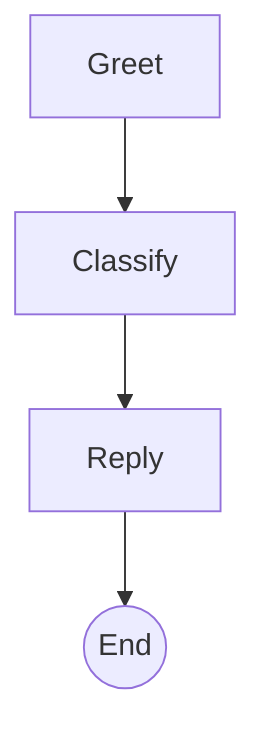
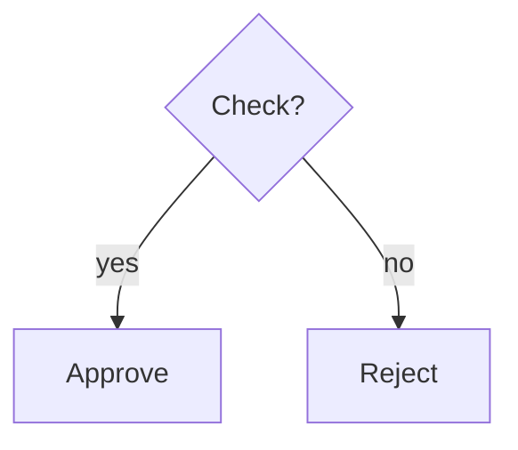
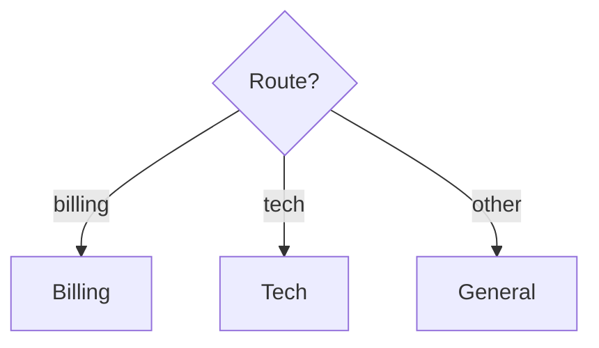
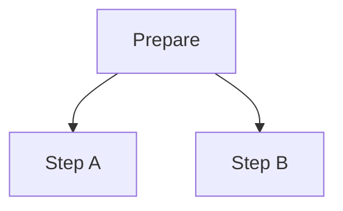
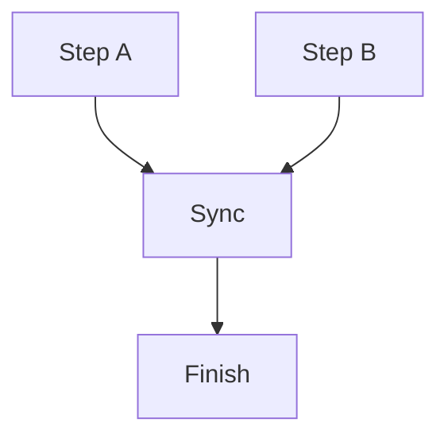
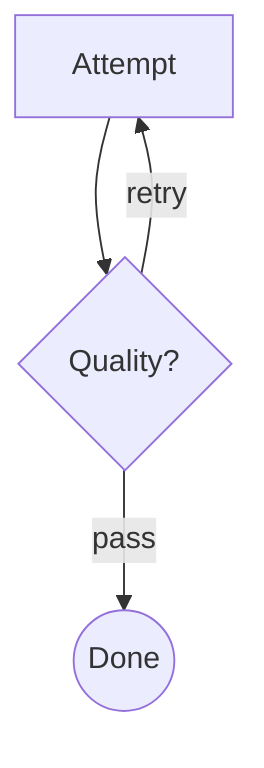
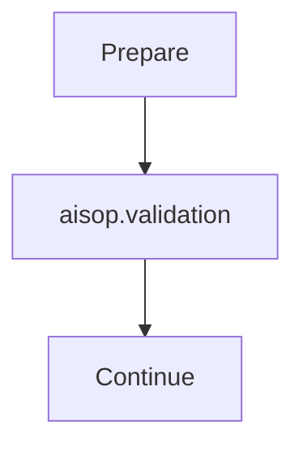
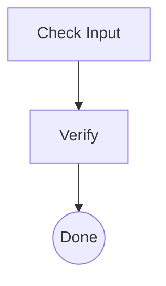
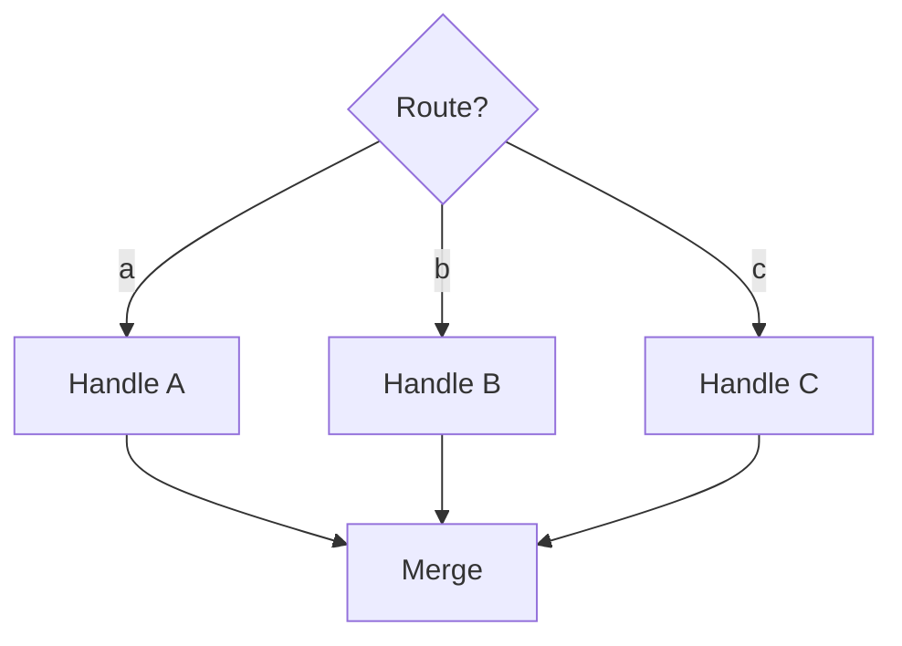
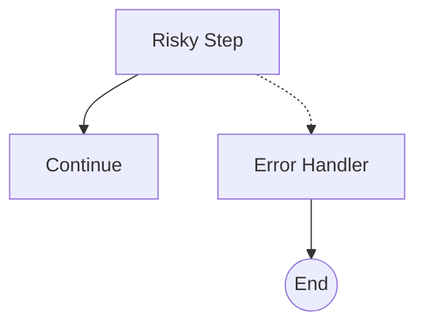

# Mermaid vs JSON Flow：控制流对比

## 概览

| 控制结构 | Mermaid | JSON Flow | 备注 |
|---------|---------|-----------|------|
| 顺序 | 支持 | 支持 | 等价 |
| 二分支 | 支持 | 支持 | 等价 |
| 多分支 | 支持 | 支持 | 等价 |
| 并行分叉 | 支持 | 支持 | 等价 |
| 并行汇合 | 支持 | 支持 | JSON Flow 更明确 |
| 回环 | 支持 | 支持 | 等价 |
| 子流程 | 支持 | 支持 | JSON Flow 有 `delegate_to` |
| 收敛 | 支持 | 支持 | 等价 |
| 错误路由 | 支持 | 支持 | 两者都有原生错误边 |

---

以下均为拓扑片段，不是独立的两消息AISOP程序；部分片段省略目标定义。完整子图示例见reference目录，调用规则见规范§4.4。

控制流含义等价不保证模型输出或外部副作用完全相同。参考解析器仅支持有限 Mermaid 子集，不提供完整双向转换器，也不是运行时执行证明。

## 逐项对比

### 1. 顺序

**Mermaid：**


**JSON Flow：**
```json
{
  "greet":    { "next": ["classify"] },
  "classify": { "next": ["reply"] },
  "reply":    { "next": ["end"] },
  "end":      {}
}
```

---

### 2. 二分支

**Mermaid：**


**JSON Flow：**
```json
{
  "check": { "branches": { "yes": "approve", "no": "reject" } }
}
```

---

### 3. 多分支

**Mermaid：**


**JSON Flow：**
```json
{
  "route": {
    "branches": { "billing": "billing", "tech": "tech", "other": "general" }
  }
}
```

---

### 4. 并行分叉

**Mermaid：**


**JSON Flow：**
```json
{
  "prepare": { "next": ["step_a", "step_b"] }
}
```

---

### 5. 并行汇合

**Mermaid：**


**JSON Flow：**
```json
{
  "step_a": { "next": ["sync"] },
  "step_b": { "next": ["sync"] },
  "sync":   { "wait_for": ["step_a", "step_b"], "next": ["finish"] }
}
```

JSON Flow 的 `wait_for` 可以明确列出前驱节点。Mermaid 的汇聚是拓扑，本身不是 join 配置；运行时合并与等待行为由函数中适用的 `join` 配置提供。两种形式遵循相同的 AISOP 执行规则。

---

### 6. 回环

**Mermaid：**


**JSON Flow：**
```json
{
  "attempt": { "next": ["check"] },
  "check":   { "branches": { "retry": "attempt", "pass": "done" } }
}
```

---

### 7. 子流程（Delegate）

**Mermaid：**


子任务（`validation`）：


**JSON Flow：**

主任务：
```json
{
  "prepare":  { "next": ["call_sub"] },
  "call_sub": { "delegate_to": "validation", "next": ["continue_main"] }
}
```

子任务（`validation`）：
```json
{
  "check_input": { "next": ["verify"] },
  "verify":      { "next": ["done"] },
  "done":        {}
}
```

两者都支持子任务复用。Mermaid 通过节点标签 `aisop.<sub>` 表达委派。JSON Flow 使用 `delegate_to` 字段。

两种格式都支持整步 `RUN aisop.<name>`，可追加 ` -> <variable>`；名字使用功能标识符。无同目标显式步骤时先准备再按标签或裸delegate_to调用；有同目标显式步骤时按实际到达的步骤逐次调用，标签不再追加。返回后才判断分支；局部路由留在本图，错误按§6.12回传。静态检查不证明真实执行、确认或返回。

---

### 8. 收敛

**Mermaid：**


**JSON Flow：**
```json
{
  "route":    { "branches": { "a": "handle_a", "b": "handle_b", "c": "handle_c" } },
  "handle_a": { "next": ["merge"] },
  "handle_b": { "next": ["merge"] },
  "handle_c": { "next": ["merge"] },
  "merge":    { "next": ["end"] }
}
```

---

### 9. 错误路由

**Mermaid：**


**JSON Flow：**
```json
{
  "risky_step": {
    "next": ["continue"],
    "error": "error_handler"
  },
  "error_handler": {
    "next": ["end"]
  }
}
```

两者都有原生错误路由。Mermaid 使用虚线边 `-.->`. JSON Flow 使用 `error` 字段。两者都支持通过函数中的 `on_error` 进行精细错误路由。

---

## 总结

| 维度 | Mermaid | JSON Flow |
|------|---------|-----------|
| 用途 | 紧凑的可视化表示 | 显式结构字段 |
| Token 数量 | 取决于 tokenizer、流程和格式化 | 取决于 tokenizer、流程和格式化 |
| LLM 理解度 | 取决于模型与任务，本页未做基准测试 | 取决于模型与任务，本页未做基准测试 |
| 机器可读 | 需要 Mermaid 解析器 | 原生 JSON |
| 错误处理 | `-.->` 虚线边 + `on_error` | `error` 字段 + `on_error` |
| 并行汇合 | 视觉汇聚 + 函数中的 `join` | 明确的 `wait_for` + 函数中的 `join` |
| 子任务 | `aisop.<sub>` 节点标签 + `RUN aisop.sub` | `delegate_to` 字段 + `RUN aisop.sub` |
| 可视化 | 支持表示范围内的 Mermaid 渲染 | 需要渲染器或转换器，本库不提供完整往返转换工具 |

**设计原则**：两种格式共享相同的函数定义（§5）和元数据格式（§2）。唯一区别是流程图（§4）的表达方式 — Mermaid 字符串 vs JSON flow 对象。两种格式可以在同一程序中共存。

---

Align Axiom 0: Human Sovereignty and Wellbeing. Version: AISOP V1.0.0. www.aisop.dev
