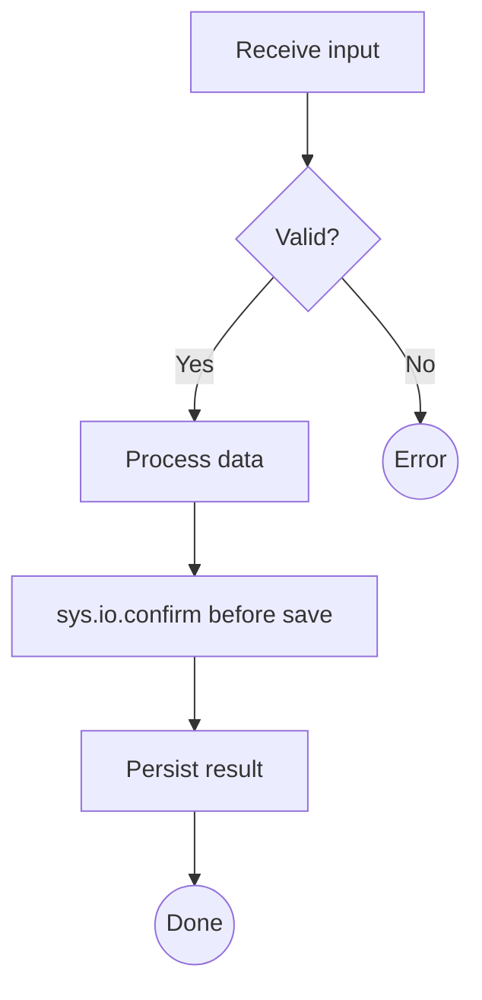

# What is AISOP?

**AISOP** stands for **AI Standard Operating Protocol**. It is an open protocol for defining structured AI programs — reproducible, portable, and human-readable workflows that span multiple steps, tools, and decisions.

---

## Why AISOP Exists

Modern AI agents face three recurring problems:

1. **Drift** — A free-form prompt produces different behavior across runs, models, or sessions
2. **Opacity** — When an agent loop fails, there is no structural record of what was supposed to happen
3. **Non-portability** — Logic written for one runtime (Cursor, Claude Code, AutoGen, etc.) cannot be lifted to another

AISOP addresses all three by giving AI programs a **structural definition** that any conformant runtime can execute identically.

---

## The Core Idea

An AISOP program is a single `.aisop.json` file containing:

- A **flow graph** (Mermaid or JSON Flow) — the program's control structure
- **Function definitions** — what each node does, step by step
- **`sys.*` system calls** — protocol-reserved primitives for I/O, assertions, code execution, state management
- **Sub-graph composition** — `aisop.<sub>` references for reusable building blocks



The above graph is **executable** — any AISOP-conformant runtime parses it, dispatches each node, and produces deterministic side effects.

---

## What AISOP Is

- A **format protocol** — defines syntax and execution semantics for `.aisop.json`
- A **dual-representation standard** — Mermaid (human-friendly) and JSON Flow (machine-direct), with bidirectional equivalence
- A **`sys.*` family** — 24 protocol-reserved system calls across 8 namespaces (I/O, run, assert, llm, code, state, event, security)
- An **execution contract** — `sys.io.confirm` is forced-blocking at all trust levels, encoding Axiom 0 mechanically

---

## What AISOP Is Not

- **Not a runtime** — That is [SoulBot](https://github.com/AIXP-Labs/SoulBot)'s job
- **Not a governance framework** — That is [AIAP](https://github.com/AIXP-Labs/AIAP)'s job (quality rules, trust levels, compliance gates)
- **Not a sandbox** — Tool resolution and permission enforcement happen at the runtime layer
- **Not a prompt template language** — AISOP defines program structure; prompt content is the program author's responsibility

---

## Comparison with Other Approaches

| Approach | What it provides | What AISOP adds |
|----------|-----------------|----------------|
| Free-form prompts | Maximum flexibility | Determinism + reproducibility |
| LangGraph / AutoGen | Python-native agent loops | Portable, language-neutral format |
| MCP | Tool invocation protocol | Program-level structure (MCP doesn't define multi-step flow) |
| BPMN 2.0 | Business process modeling | AI-agent-specific primitives (`sys.*`), simpler syntax |
| Anthropic Agent Skills | Markdown-based skill format | Multi-step control flow, branching, error edges |

AISOP is **complementary** to most of these — for example, an AISOP program can call MCP tools and run inside a LangGraph wrapper.

---

## Quick Tour

### Minimal AISOP file

```json
{
  "protocol": "AISOP V1.0.0",
  "version": "1.0.0",
  "name": "hello",
  "flow_format": "mermaid",
  "aisop": {
    "main": "graph TD\n    Start[Greet user] --> EndOk((Done))"
  },
  "functions": {
    "Start": {
      "description": "Print a greeting",
      "steps": ["sys.io.print('Hello, AISOP!')"]
    }
  }
}
```

### What a runtime does with this

1. Parse the Mermaid graph (or accept JSON Flow equivalent)
2. Walk nodes from `Start` through to `EndOk`
3. For each node, classify each step as `sys.*` call, `RUN aisop.*` sub-task, or natural language
4. Dispatch `sys.*` to the runtime's primitive handler
5. Return when end-node reached

The same `.aisop.json` runs identically in the [Python reference implementation](https://github.com/AIXP-Labs/AISOP/tree/main/reference/python) and the [JavaScript reference implementation](https://github.com/AIXP-Labs/AISOP/tree/main/reference/javascript).

---

## Where to Go Next

| You want to... | Read |
|---------------|------|
| Understand the dual-format equivalence | [Mermaid vs JSON Flow](comparison-mermaid-vs-jsonflow.md) |
| See performance trade-offs | [Performance Comparison](performance-mermaid-vs-jsonflow.md) |
| Read the full normative spec | [`specification/aisop-spec.md`](https://github.com/AIXP-Labs/AISOP/blob/main/specification/aisop-spec.md) |
| Run a reference implementation | [`reference/python/`](https://github.com/AIXP-Labs/AISOP/tree/main/reference/python) or [`reference/javascript/`](https://github.com/AIXP-Labs/AISOP/tree/main/reference/javascript) |
| Understand AISOP's role in the AIXP family | [`GOVERNANCE.md`](https://github.com/AIXP-Labs/AISOP/blob/main/GOVERNANCE.md) |

---

Align Axiom 0: Human Sovereignty and Wellbeing. Version: AISOP V1.0.0. www.aisop.dev
