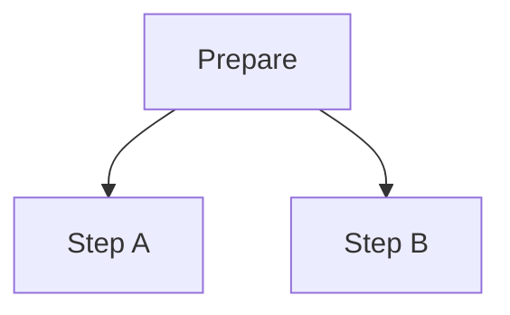
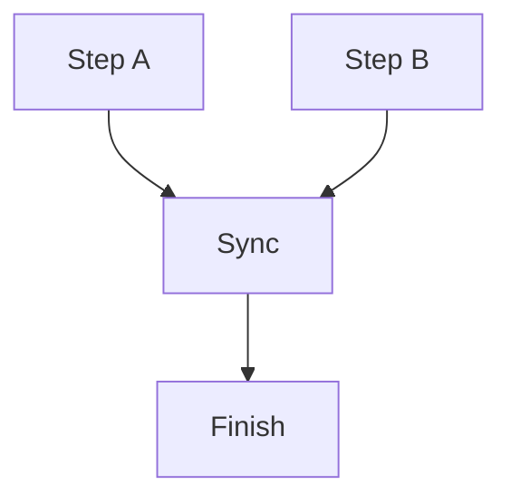
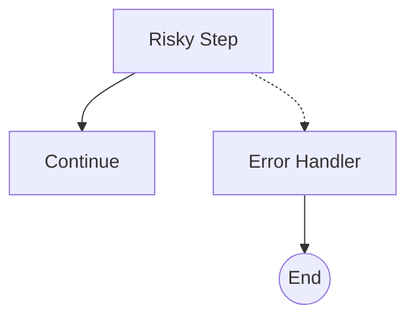
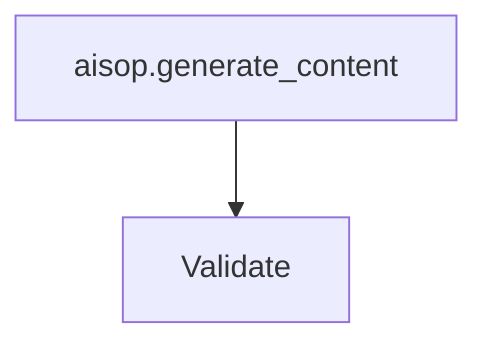
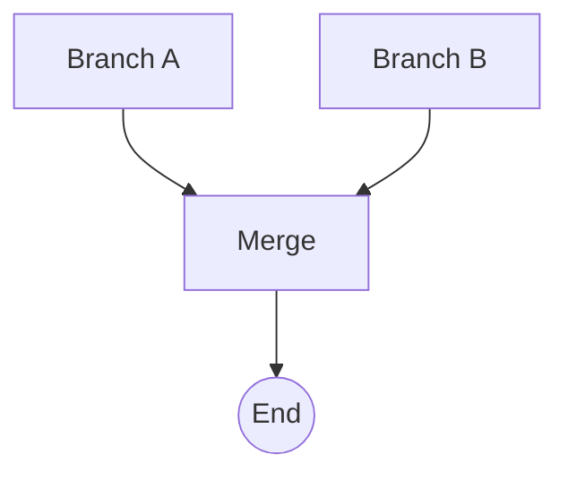
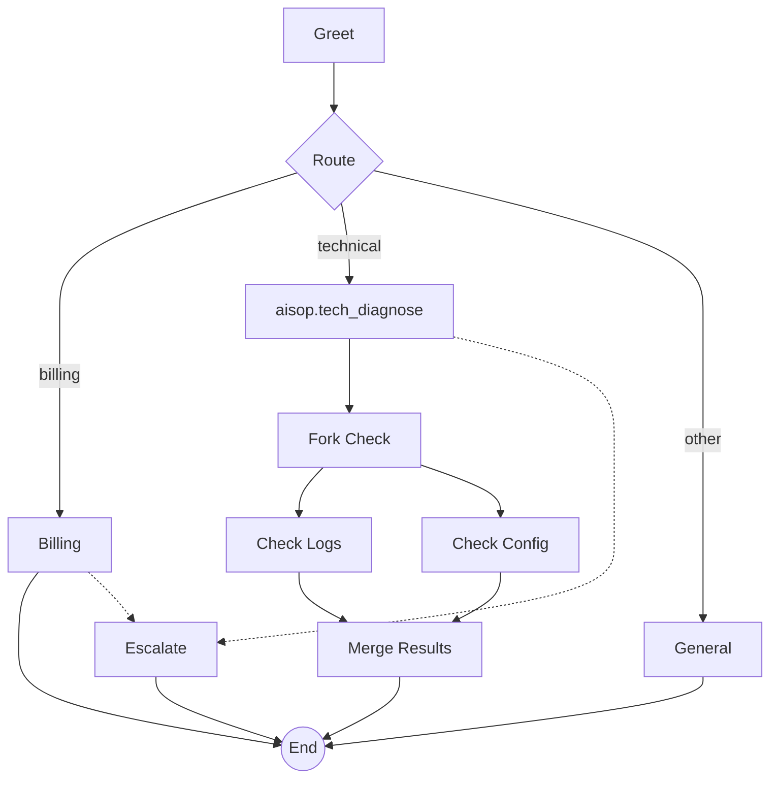

# AISOP V1.0.0 Specification

## 0. Axiom

### Axiom 0: Human Sovereignty and Wellbeing

The AISOP protocol acknowledges the following irrevocable premises:

1. **Human Sovereignty First**: AI systems exist to serve humanity, not to replace or dominate it. Final authority over all instructions, flows, and decisions rests with humans.
2. **Wellbeing is Non-Negotiable**: AI programs must not harm human physical or mental health, dignity, or freedom in any form. When an instruction conflicts with human wellbeing, wellbeing takes precedence.
3. **Transparency and Accountability**: AI behavior must be understandable, traceable, and open to challenge. Concealed intent or evasion of responsibility violates this axiom.
4. **Do No Harm**: AI must not produce outputs that deceive, manipulate, injure, or exploit humans, regardless of the instruction source.

> This axiom cannot be overridden by any program, instruction, or protocol extension. All AISOP-compliant implementations must enforce this axiom at the highest level of execution priority.

---

## 1. File Format

Input bytes must be valid UTF-8; one leading BOM is tolerated once, not two. JSON grammar is strict: reject trailing data, NaN/Infinity extensions and duplicate decoded object keys. Each object's key set is independent; escaped and literal spellings of the same key are duplicates, but case and Unicode normalization are not folded.

All parsed numbers must be finite and have absolute value at most 9007199254740991 (2^53 - 1). This is a parsed-number rule, not decimal exactness: binary64 rounding may turn 1e-400 into 0, and -0 compares equal to 0. Booleans are not numbers. The same bound applies to expression number literals and numeric context values actually read (§6.11).

Decoded keys and strings must contain Unicode scalar values: reject lone surrogate halves; allow valid pairs, non-BMP characters and Chinese. Preserve a BOM inside string data. Do not strip data or change process-wide decoder, integer or depth limits.

The reference load API rejects these input failures with ValueError/Error carrying code AISOP_E_JSON_INPUT. Native IO errors retain their native identity; successfully decoded but structurally invalid AISOP still raises its existing SUBGRAPH error, not JSON_INPUT. Its private iterative number/Unicode walk is limited to the newly parsed JSON tree.

check(data) checks only the structure it visits; it cannot recover duplicate source keys or certify every payload in an already parsed host object. An invalid visited diagnostic key produces SHAPE at a safe ancestor/root instead of crashing during location encoding. This adds no arbitrary-host-object or cyclic-object conformance rule.

AISOP files use the `.aisop.json` extension. A valid file is a JSON array with exactly two elements:

```json
[
  { "role": "system", "content": { ... } },
  { "role": "user",   "content": { ... } }
]
```

---

## 2. `system` — Program Metadata

Program identity, description, and system-level configuration.

```json
{
  "role": "system",
  "content": {
    "protocol": "AISOP V1.0.0",
    "axiom_0": "Human_Sovereignty_and_Wellbeing",
    "id": "my_program",
    "name": "My Program",
    "version": "1.0.0",
    "summary": "One-sentence description",
    "description": "Detailed description",
    "flow_format": "mermaid",
    "loading_mode": "normal",
    "tools": ["tool_name"],
    "params": { "param_name": "string" },
    "system_prompt": "{system_prompt}"
  }
}
```

| Field | Type | Required | Description |
|-------|------|----------|-------------|
| `protocol` | string | yes | Protocol version, e.g. `"AISOP V1.0.0"` |
| `axiom_0` | string | yes | Immutable Foundation Value: `Human_Sovereignty_and_Wellbeing` |
| `id` | string | yes | Unique program identifier |
| `name` | string | yes | Display name |
| `version` | string | yes | Semantic version |
| `summary` | string | no | One-sentence capability overview |
| `description` | string | no | Detailed description |
| `flow_format` | string | yes | `"mermaid"`, `"jsonflow"`, or `"hybrid"`. Required; no default. |
| `loading_mode` | string | no | `"normal"` = load full program, `"node"` = on-demand function loading, `"lite"` = AI loads functions as needed. Default: `"normal"` |
| `tools` | string[] | no | Tool declarations |
| `params` | object | no | Optional simple input types: string, number, boolean, array, object or null (type names are strings); not defaults or required inputs |
| `system_prompt` | string | no | System prompt (supports variable substitution) |

---

## 3. `user` — Instruction & Flow

Contains the execution instruction, user input, flow graph, and function definitions.

```json
{
  "role": "user",
  "content": {
    "instruction": "RUN aisop.main",
    "user_input": "{user_input}",
    "aisop": { ... },
    "functions": { ... }
  }
}
```

| Field | Type | Required | Description |
|-------|------|----------|-------------|
| `instruction` | string | yes | Execution directive |
| `user_input` | string | no | User message (supports variable substitution). Optional — not needed for automated/scheduled tasks or Bot-to-Bot invocations. |
| `aisop` | object | yes | Flow graph definition (see §4) |
| `functions` | object | yes | Function definitions (see §5) |

---

## 4. `aisop` — Flow Graph

Defines one or more tasks. Each task value can be:

- **string** — Mermaid flow graph
- **object** — JSON flow graph

Both formats can coexist in the same program. Runtime detects format by value type.

```json
{
  "aisop": {
    "main": "graph TD\n    classify{Classify} -->|yes| approve[Approve]\n    classify -->|no| reject[Reject]\n    approve --> end_node((End))\n    reject --> end_node",
    "validation": {
      "check_input": { "next": ["verify"] },
      "verify":      { "next": ["done"] },
      "done":        {}
    }
  }
}
```

### 4.1 Tasks

| Field | Description |
|-------|-------------|
| `main` | Primary task (required). Execution entry point. |
| Other keys | Sub-tasks (optional). Called via delegate nodes (see §4.2) or step-level `RUN aisop.<sub>` (see §5.2.1). |

The first node in each task is the entry node. Graph and node names follow §4.4; main is not a nested call target.

### 4.2 Mermaid Format

#### 4.2.1 Node Shapes

Mermaid node shapes determine the node's role in the flow:

| Shape | Syntax | Behavior | Example |
|-------|--------|----------|---------|
| Rectangle | `name[text]` | Process — execute then proceed | `greet[Greet User]` |
| Diamond | `name{text}` | Decision — conditional branching | `route{Route Intent}` |
| Circle | `name((text))` | End — terminate the task | `end_node((End))` |
| Rectangle | `name[aisop.sub]` | Delegate — call sub-task `sub` | `call[aisop.validation]` |

A rectangle delegates only when its whole label, after optional outer quotes, equals `aisop.<name>`. A rectangle label starting with `aisop.` but not matching the complete delegate form is invalid, not an ordinary process label. See §4.4.

#### 4.2.2 Edge Types

Mermaid edge types determine the connection semantics:

| Edge | Syntax | Meaning | Example |
|------|--------|---------|---------|
| Solid arrow | `-->` | Normal flow (next) | `greet --> classify` |
| Labeled arrow | `-->\|label\|` | Branch (conditional) | `route -->\|billing\| billing_handler` |
| Dashed arrow | `-.->` | Error routing | `risky_step -.-> error_handler` |

Supported arrows are `-->`, `-->|label|`, `--> |label|`, `-- label -->` and `-.->`. `A & B --> C & D` expands to A→C, A→D, B→C and B→D. In `x["text"]`, outer quotes delimit the label; arrows, &, pipes and brackets inside quotes are text, not connections.

In the reference subset, quote protection starts when the first non-W character of a node/branch label region is a single or double quote. Its matching, unescaped closing quote may be followed only by W before the label delimiter. Ordinary apostrophes and quotes inside unquoted prose, such as Don't or He said "go", are data and do not start quote protection. Unclosed quotes or extra non-W suffixes produce PARSE_PARTIAL rather than a complete parsed line.

Protection and output are separate: node-label text is not trimmed; remove one outer quote pair only when it occupies the exact first and last characters. Thus `a[ "x ] y" ]` protects the inner bracket but retains its spaces and quotes as label data. Branch-label outer W is trimmed before removing one outer quote pair; quoted inner spaces remain. Backslashes protect the next character for boundary recognition, but remain in the output. JSON decoding happens once, not again inside a label.

The reference parser uses the following fixed whitespace set W, not host strip/trim or Unicode-property defaults:

~~~text
[\u0009-\u000D\u0020\u00A0\u1680\u2000-\u200A\u2028\u2029\u202F\u205F\u3000]
~~~

W applies to whole-step boundaries, graph-line/endpoint boundaries, declaration whitespace and branch-label outer padding. Node-label data is preserved. Fixed `RUN `, store separators and arrow-token gaps retain their existing ASCII space/TAB rules; do not normalize other separators into valid syntax. Graph lines split only on CRLF, LF or CR; U+2028/U+2029 inside label data remain characters, not new graph lines.

U+001C-U+001F, U+0085 and U+FEFF (B) are not syntax whitespace. W padding around a valid whole call is accepted; explicit B-wrapped or invalidly spaced RUN candidates and mixed prose followed by a call after comma/semicolon (including ，；、) are CALL_SYNTAX errors. This is finite candidate recognition, not arbitrary prose analysis. Retain definite graph NAME errors and PARSE_PARTIAL/empty-graph SHAPE boundaries; do not silently remove invalid characters or downgrade every case to a warning.

#### 4.2.3 Parallel Fork and Join

**Parallel fork** — one node with multiple `-->` edges to different targets:



**Parallel join** — multiple nodes `-->` converging to one node:



The join node's runtime behavior (merge strategy, timeout) is configured via the `join` key in functions (see §5.2.2). Mermaid shows the visual convergence; functions define the runtime semantics.

#### 4.2.4 Error Routing

Any node can have a dashed error edge `-.->` to an error handler node:



The `-.->` edge is a topology-level error edge. For fine-grained error routing by error type, see `on_error` in §5.2.4.

#### 4.2.5 Control Flow Summary

| Pattern | Mermaid Syntax |
|---------|---------------|
| Sequential | `A --> B` |
| If/else (2-way) | `A -->\|yes\| B`, `A -->\|no\| C` |
| Switch (N-way) | `A -->\|label1\| B`, `A -->\|label2\| C`, ... |
| Parallel fork | `A --> B`, `A --> C` (same source) |
| Parallel join | `B --> D`, `C --> D` (same target) |
| Loop | Branch target points to earlier node |
| Delegate | `A[aisop.sub]` node text |
| Convergence | Multiple nodes `-->` same target |
| Error routing | `A -.-> E` |

### 4.3 JSON Flow Format

A JSON flow graph is an object where each key is a node name and each value defines the node's connections.

#### 4.3.1 Node Structure

| Field | Type | Description |
|-------|------|-------------|
| `next` | string[] | Next node(s). 1 = sequential, 2+ = parallel fork |
| `branches` | object | Conditional branching: `{label: target_node}` |
| `error` | string | Error handler node |
| `delegate_to` | string | Call a sub-task by name |
| `wait_for` | string[] | Convergence topology; join behavior additionally requires join configuration and multiple normal incoming edges. |

All fields are optional. An empty object `{}` represents an end node.

#### 4.3.2 Node Type Inference

Node behavior is inferred from structure (by priority, highest first):

| Priority | Structure | Inferred behavior |
|----------|-----------|-------------------|
| 1 | Empty object `{}` | End — terminate the task |
| 2 | Has `delegate_to` | Delegate — call subgraph, then evaluate branches or continue to next |
| 3 | Has `branches` | Decision — route based on condition |
| 4 | Has `wait_for` | Convergence topology — when join is active, complete it and execute this node's steps, then continue to `next` |
| 5 | Has `next` (2+ targets) | Parallel fork — execute targets concurrently |
| 6 | Has `next` (1 target) | Process — execute then proceed |

wait_for describes convergence topology; join behavior additionally requires join configuration in functions and multiple normal incoming edges. Apply this priority table only without conflicting node-level modes; delegation with an active join is invalid (§5.3).

#### 4.3.3 Error Routing

Any node can define an `error` field. When an error occurs, execution routes to the error handler node instead of `next`.

```json
{
  "risky_step": {
    "next": ["continue"],
    "error": "error_handler"
  }
}
```

#### 4.3.4 Example

```json
{
  "aisop": {
    "main": {
      "start":    { "next": ["gen"] },
      "gen":      { "delegate_to": "generate_content", "next": ["fork"] },
      "fork":     { "next": ["branch_a", "branch_b"] },
      "branch_a": { "next": ["merge"] },
      "branch_b": { "next": ["merge"] },
      "merge":    { "wait_for": ["branch_a", "branch_b"], "next": ["end"] },
      "end":      {}
    },
    "generate_content": {
      "scaffold": { "next": ["content"] },
      "content":  { "next": ["done"] },
      "done":     {}
    }
  }
}
```

### 4.4 Subgraphs and Calls

1. **Structure:** main and subgraphs are peers in aisop; no extra subgraph container exists. sub_mermaid and sub_jsonflow describe value formats, not new fields.
2. **Names:** Graph, node and RUN-result variable names match `[A-Za-z_][A-Za-z0-9_]*`. Prefer functional names; sub itself is not forbidden. JSON delegate_to contains only the bare graph name.
3. **Entry:** main is required and entered by the top-level instruction. Nested calls to main are invalid. Each graph starts at its first declared node.
4. **Calls:** Use a whole Mermaid label `aisop.<name>` (optional outer quotes), JSON `delegate_to: "<name>"`, or a whole step `RUN aisop.<name>` optionally followed by ` -> <variable>`. Index notation, RUN in node labels and mixed prose/call steps are invalid. A rectangle's reserved `aisop.` prefix must match the complete delegate form. For a fully parsed rectangle, inspect its original label region: trim W/B, remove at most one complete outer quote pair, then trim that layer's W/B. If this copy starts with aisop. but the original is not a valid delegate, report CALL_SYNTAX without repairing it. Public label data remains unchanged; a["'aisop.helper'"] stays ordinary data.
5. **Resolution:** Look in this file first. Invalid local targets cannot be replaced by external ones. A standalone file resolves locally; a program component may use a consumer-supplied resolver. Unresolved targets are not verified. A callback result is a consumer claim, not external trust proof.
6. **Order and count:** Without an explicit same-target RUN, execute preparation steps then the node-level call. With explicit same-target RUN steps, call at each actually reached step and do not add a label/delegate call. Other-target RUN steps remain preparation. Failure, rejection or termination can prevent later calls. Prefer multiple nodes or a loop for repeated calls; this is not an extra lint rule.
7. **Context and result:** Respect context_filter. Optional -> binds the callee's explicitly defined business completion output, not the whole context or an implicit last_result. Use existing output_mapping/state for explicit transfer; no new return field or universal result shape is introduced.
8. **Return:** After subgraph completion, resume the caller's next step, then its routing; completing main ends the program. Execute terminal-node steps before completing. Parent node-local variables survive the call until that parent completes (§6.9); child-local variables do not leak.
9. **Local routes and errors:** next, branches, error, wait_for and on_error targets belong to the current graph, including every graph that uses a shared function. Missing runtime targets and unhandled child errors follow §6.12. on_error cannot downgrade static errors.
10. **Cycles:** Local subgraph call cycles, including self-calls, are invalid. Ordinary control-flow loops are not subgraph recursion. This does not certify termination or cross-file acyclicity.
11. **Shared nodes:** Identical node names use the same functions definition. Warn on reuse unless all occurrences are entries or all are terminal nodes; these roles may overlap. Exemption is not proof of safety or isolation.
12. **Formats:** flow_format is required: mermaid permits string graphs, jsonflow permits object graphs, and hybrid permits both. No default is supplied.
13. **Post-call branches:** Delegate behavior takes precedence over branches. Preserve conditional routes and evaluate them after the call returns.
14. **Unused graphs:** Warn for non-main graphs with no valid local incoming call. This is not proof of reachability from main; partial parsing cannot justify definite unused claims.
15. **Confirmation:** Existing sys.io.confirm steps remain mandatory when reached, including in subgraphs. Each actually reached confirmation needs its own human response; never merge, skip or reuse approval. Static checking cannot prove runtime enforcement.

This fragment is not a complete program. See [the complete subgraph example](../reference/python/example_subgraphs.aisop.json) for the two messages, all functions and the business output definition.

```json
{"aisop":{"main":"graph TD\n    intake[Read] --> diagnose[aisop.diagnose]\n    diagnose --> reply[Reply]\n    reply --> end_node((End))","diagnose":"graph TD\n    gather_info[Gather] --> analyze[Analyze]\n    analyze --> diagnose_done((Done))","extract_keywords":{"parse":{"next":["rank"]},"rank":{"next":["keywords_done"]},"keywords_done":{}}},"functions":{"gather_info":{"step1":"Prepare text","step2":"RUN aisop.extract_keywords -> keywords","step3":"Use keywords in this node"}}}
```

The reference checker supports finite syntax, not execution: unsupported Mermaid lines yield PARSE_PARTIAL, not complete conformance. Without a resolver a missing component target is WARNING; standalone=True makes it ERROR. A resolver must return a strict boolean, and exceptions or other values are errors. It cannot override a broken local graph.


---

## 5. `functions` — Function Definitions

Defines what each node does and how it behaves at runtime. Keyed by node name. Each value contains execution steps and optional runtime behavior configuration.

```json
{
  "functions": {
    "classify": { "step1": "Classify user intent" },
    "process":  { "step1": "Process the request", "step2": "Return result" },
    "reply":    { "step1": "Generate a friendly reply" }
  }
}
```

**Field order convention** — the recommended order within a function definition, from core logic to auxiliary metadata:

| Order | Fields | Purpose |
|-------|--------|---------|
| 1 | `step1`, `step2`, ..., `stepN` | Execution steps (core logic) |
| 2 | Reserved keys (`join`, `map`, `on_error`, `retry_policy`, `context_filter`, `output_mapping`) | Runtime behavior configuration |
| 3 | `constraints` | Boundary rules |
| 4 | `execute_mode` | Dispatch mode (optional, last) |

### 5.1 Node Naming Convention

Node names can use a `_function` suffix to hint at the node's role within the flow. This helps the AI runtime understand node semantics without exposing internal structure to the user.

| Convention | Example | Meaning |
|------------|---------|---------|
| `xxx_function` | `execute_function`, `classify_function` | Functional step |
| `end_function` | `end_function` | Termination with final output |

This convention is optional. Semantic names like `greet`, `classify`, `search` are equally valid.

### 5.2 Reserved Keys

Keys in a function body fall into two categories:

- **Execution steps**: keys must match `step[1-9][0-9]*`; execute by numeric N, not member declaration or lexical order. Gaps and arbitrarily long positive indices are allowed.
- **Reserved keys** (`RESERVED_KEYS`): recognized as behavior configuration, not executed as steps

| Key | Type | Description |
|-----|------|-------------|
| `join` | object | Join runtime config (merge_strategy, timeout_seconds) |
| `map` | object | Iterate over a collection in parallel |
| `on_error` | object | Route errors by type to handler nodes |
| `retry_policy` | object | Auto-retry on failure with backoff |
| `context_filter` | object | Restrict input context for this node |
| `output_mapping` | string | Store output under a specific key |
| `constraints` | string\|array | Constraint declarations (not executed) |
| `execute_mode` | string | Execution dispatch mode: `"inline"` (default) or `"agent"`. See §5.2.8 |

> **Note:**
> - Delegate and join topology are defined in Mermaid (see §4), not in functions.
> - `join` in functions contains only runtime config (`merge_strategy`, `timeout_seconds`). The visual convergence is shown in Mermaid.

**Runtime parsing rule:**
- Valid stepN keys with nonempty string values after trimming fixed W → execution steps; whitespace is used only for this check, not to rewrite data.
- Unknown non-reserved keys (including step0, step01 and Step1), non-string or W-only step values are static errors, even in unreferenced functions. They are not executed or queried as calls; other valid steps remain independently checked.
- Keys IN `RESERVED_KEYS` → behavior configuration

Step indices are sorted by their decimal digit count and digits, never by conversion to a bounded host number. Zero-step and configuration-only functions are allowed; graph node declaration order and entry selection are unchanged.

When migrating, review confirmation, value production/use and calls if member order differs from numeric step order. Authors must decide any renumbering; do not silently rename unknown keys, delete confirmation or move ordinary prose into constraints. Static call checks do not prove business equivalence.

#### 5.2.1 Sub-task Invocation

Sub-tasks can be invoked in two ways. Neither is a `RESERVED_KEY`:

**(a) Node-level delegate (topology, see §4.2):**

Delegate is expressed in Mermaid via node text `aisop.<sub_name>`. The Mermaid graph shows the delegation visually.



If a delegate node needs additional runtime configuration, add steps in functions:

```json
"gen": { "step1": "Prepare context before calling sub-task" }
```

**(b) Step-level `RUN aisop.<sub>` (behavior, inside function):**

Each call occupies a whole step: `RUN aisop.<name>` or `RUN aisop.<name> -> <variable>`. See §4.4 for ordering, return and resolution; the top-level instruction remains `RUN aisop.main`.

| Level | Location | Syntax | Scenario |
|-------|----------|--------|----------|
| Node-level | §4 Mermaid | `name[aisop.sub]` | Entire node delegates to sub-task |
| Step-level | §5 function step | `RUN aisop.sub` as a whole step | Call between preparation and result-handling steps |

Node-level = Mermaid can draw it (topology).
Step-level = Mermaid cannot draw it (behavior, hidden inside function).

```json
"function_one": {
  "step1": "Do something",
  "step2": "RUN aisop.extract_keywords",
  "step3": "Continue with extracted keywords"
}
```

Execution: step1 → step2 (enters extract_keywords sub-task, returns after completion) → step3

> **Non-conformant:** Mixing natural language and a RUN call in one step violates one-step-one-mode (§6.1). Use separate steps. Clear malformed call syntax is an error, not a deprecated alternative.

Mixed-step checking first accepts a valid whole RUN, then preserves explicit malformed-prefix, spacing, B-wrapping and indexed-call diagnostics. Otherwise an unquoted RUN aisop. candidate at the beginning or after a non-ASCII-identifier character makes a non-whole call CALL_SYNTAX, including in a sys.-prefixed step. The identifier boundary is [A-Za-z0-9_], not a Unicode word rule or punctuation list; fooRUN and foo_RUN are not new candidates.

Only matched unescaped single/double quotes starting at the beginning or after a non-ASCII-identifier character protect literal text; odd/even consecutive backslashes determine escaping. Word apostrophes such as Don't do not open protection; an unmatched quote cannot hide the rest of the step. This finite scan does not rewrite data, parse all sys arguments or prove arbitrary prose safe.

#### 5.2.2 `join`

Mermaid shows visual convergence (multiple edges to one node). The `join` key in functions contains only runtime configuration: how to merge, how long to wait.

After join completion, execute this node's own steps once per execution attempt; retries do not provide exactly-once side effects. This rule does not redefine when join completes or change merge_strategy or timeout behavior.

| Field | Type | Required | Description |
|-------|------|----------|-------------|
| `merge_strategy` | string | no | `"merge"` / `"array"` / `"first"`. Default: `"merge"` |
| `timeout_seconds` | number | no | Timeout in seconds. Default: none |

`merge_strategy` options:
- `merge`: Merge into a single object
- `array`: Collect as an array
- `first`: Take only the first completed result
- On timeout, the branch gets `{error: "timeout"}`

**Mermaid (§4) — topology (visual convergence):**



**Function (§5) — behavior (how to merge):**

```json
"merge_results": {
  "step1": "Process the merged branch results",
  "join": {
    "merge_strategy": "array",
    "timeout_seconds": 120
  }
}
```

#### 5.2.3 `map`

Iterate over a collection, executing a specified function for each element. After item processing completes under the configured policy, execute this node's own steps once per execution attempt.

With `on_item_error: "fail"`, an item failure fails this node attempt without executing its own steps and follows §5.2.4 and §6.12. Existing retries do not imply rollback or exactly-once side effects; this rule adds no in-flight cancellation policy. With `skip` or `collect`, finish item processing under that policy before the node's own steps.

An empty collection performs no iterations but still executes the node's own steps once. An invalid items_path is not an empty collection. This rule adds no result field or universal aggregation shape.

| Field | Type | Required | Description |
|-------|------|----------|-------------|
| `items_path` | string | yes | Path to the collection (e.g. `"state.items"`) |
| `iterator` | string | yes | Function name to execute for each item |
| `concurrency` | number | no | Max parallel executions. Default: 1, Max: 10 |
| `max_items` | number | no | Maximum items to process |
| `on_item_error` | string | no | `"skip"` / `"fail"` / `"collect"`. Default: `"fail"` |

```json
"batch_search": {
  "step1": "Summarize the completed search results",
  "map": {
    "items_path": "state.keywords",
    "iterator": "search_one",
    "concurrency": 3,
    "on_item_error": "collect"
  }
}
```

#### 5.2.4 `on_error`

Route errors by type to different handler nodes. More fine-grained than the Mermaid `-.->` error edge: `-.->` is a topology-level default error edge, while `on_error` provides type-based dispatch.

Matching order: exact type → default → current graph Mermaid -.-> or JSON error edge. Unhandled child errors propagate to the parent call node (§6.12). No category matching is defined.

The timeout/tool_error keys below are exact custom types; timeout does not automatically match command_timeout or confirm_timeout.

| Field | Type | Required | Description |
|-------|------|----------|-------------|
| (key) | string | — | Error type (e.g. `"timeout"`, `"tool_error"`) |
| `default` | string | no | Fallback handler if no type matches |

```json
"fetch_data": {
  "step1": "Call the external API",
  "on_error": {
    "timeout": "timeout_handler",
    "tool_error": "tool_error_handler",
    "default": "global_error"
  }
}
```

#### 5.2.5 `retry_policy`

Auto-retry on node execution failure.

| Field | Type | Required | Description |
|-------|------|----------|-------------|
| `max_attempts` | number | yes | Total attempts including initial (3 = initial + 2 retries) |
| `correction_prompt` | string | no | Prompt appended on retry |
| `backoff_factor` | number | no | Exponential backoff: wait = factor^attempt seconds |
| `jitter` | boolean | no | Add random 0–50% extra wait time. Default: `false` |

```json
"call_llm": {
  "step1": "Generate JSON output from LLM",
  "retry_policy": {
    "max_attempts": 3,
    "correction_prompt": "Previous output was not valid JSON. Please regenerate.",
    "backoff_factor": 2.0,
    "jitter": true
  }
}
```

#### 5.2.6 `context_filter`

Restrict the input context accessible to this node.

| Field | Type | Required | Description |
|-------|------|----------|-------------|
| `include` | string[] | no | Allowlist — only these fields are passed |
| `exclude` | string[] | no | Blocklist — these fields are excluded |

`include` and `exclude` are mutually exclusive.

```json
"analyze_item": {
  "step1": "Analyze the current data item",
  "context_filter": { "include": ["current_item", "config"] }
}
```

#### 5.2.7 `output_mapping`

Store node output under a specific key instead of merging into the global context.

| Field | Type | Required | Description |
|-------|------|----------|-------------|
| `output_mapping` | string | yes | Key name to store output under |

Often used with `context_filter`: filter controls input, mapping controls output.

```json
"process_item": {
  "step1": "Process and return structured result",
  "context_filter": { "include": ["current_item"] },
  "output_mapping": "processed_results"
}
```

#### 5.2.8 `execute_mode`

Declare how the executor should dispatch this function. This field is **optional** — when not declared, the function uses the default `"inline"` mode.

| Value | Meaning | Use When |
|-------|---------|----------|
| `"inline"` | Execute in current context (same process, lower overhead). **This is the default.** | Simple logic, routing, classification, quick operations |
| `"agent"` | Execute in an independent agent (isolated context, separate process) | Multi-file operations, web search, complex validation, critical decisions |

- **Default**: `"inline"`. Not declaring `execute_mode` is equivalent to `"execute_mode": "inline"`.
- **Position**: Place after `constraints` — the last field in the function definition.
- **Explicit values**: Only exact strings `"inline"` and `"agent"` are valid. Null, other types, casing changes or surrounding whitespace are static errors; no fallback is allowed, including for zero-step or unreferenced functions.
- **Capability**: This field has no implementation-defined extra values. An executor unable to support a declared mode must stop rather than silently run it inline; a valid mode is not proof of executor capability.

**Inline mode (default)** — no `execute_mode` needed:

```json
"classify_intent": {
  "step1": "Classify user input into category A, B, or C",
  "constraints": "Must select exactly one category"
}
```

**Agent mode** — explicitly declared:

```json
"complex_analysis": {
  "step1": "Analyze all modules for structural issues",
  "step2": "Generate comprehensive report",
  "constraints": "Must read all .aisop.json files",
  "execute_mode": "agent"
}
```

### 5.3 Execution Order

The runtime processes each node in the following order:

0. `execute_mode` — Determine dispatch mode (`"inline"` or `"agent"`); absent means inline. Reject invalid explicit values before execution. If agent is declared, use an independent agent; stop if unsupported rather than silently run inline.
1. `context_filter` — Filter input context
2. `retry_policy` — Wrap execution with retry logic
3. **Execute node behavior and steps** — complete any active join or map phase first, then execute valid stepN in numeric N order; node-level delegation follows §4.4
4. `on_error` — Route errors by type
5. `output_mapping` — Store output

**Step text classification** (three modes, mutually exclusive):

| Priority | Match Rule | Mode |
|----------|-----------|------|
| 1 | Starts with `sys.` | System call (see §6) |
| 2 | Whole valid `RUN aisop.<name>`, optionally ` -> <variable>` | Step-level sub-task invocation |
| 3 | Other | Natural language instruction |

One step = one mode. Mixing is not allowed. Use separate steps when combining modes. The reference classify_step/classifyStep prefix API is a lexical hint, not full call validation; use parse_call/parseCall and check. A clearly malformed call is not silently downgraded to prose.

**Node-level behavior** (own steps are not discarded):
- Delegate labels or JSON delegate_to use preparation/call/result ordering in §4.4; they do not discard preparation steps.
- If the node has multiple normal incoming edges and `join` in functions, execute its own steps after join completion; existing merge and timeout rules remain unchanged
- If the function body has `map`, process its items, then execute its own steps as specified in §5.2.3
- Delegate / join / map are mutually exclusive — a node may have at most one

Whole RUN steps inside join/map remain ordinary subgraph calls, not another node-level delegation mode. A checker may continue collecting well-formed potential call references in conflicting nodes; this does not make those nodes executable, and mode conflicts remain errors.

**Step-level sub-task invocation:**
- A whole RUN step (§5.2.1) pauses the current node, calls the target, then resumes its next step on success; explicit same-target steps suppress the extra node-level call (§4.4).
- This does not replace steps — it is a nested invocation within step execution

---

## 6. `sys.*` — System Calls

System calls are protocol-reserved operations that provide standardized system-level primitives. They are the execution-layer guarantee of Axiom 0 (Human Sovereignty).

### 6.1 Overview

System calls are written inline in step values as strings starting with `sys.`. They use function-call syntax and are parsed deterministically by the runtime (not by AI reasoning).

**Namespace architecture:**

```
sys.*
├── sys.io.*                  # Human interaction + File I/O
│   ├── sys.io.confirm()      # 🔒 Human confirmation (inviolable)
│   ├── sys.io.input()        # Human input (blocking)
│   ├── sys.io.select()       # Human selection (blocking)
│   ├── sys.io.notify()       # Notification (non-blocking)
│   ├── sys.io.print()        # Log output (non-blocking)
│   ├── sys.io.read()         # Read file (blocking)
│   └── sys.io.write()        # Write file (blocking)
├── sys.run.*                 # System execution
│   ├── sys.run()             # Execute command (blocking)
│   ├── sys.run.timeout()     # Execute with timeout (blocking)
│   └── sys.run.bg()          # Execute in background (non-blocking)
├── sys.assert()              # Runtime assertion (top-level primitive)
├── sys.llm.*                 # Explicit model invocation
│   ├── sys.llm()             # Text generation
│   ├── sys.llm.json()        # Structured JSON output
│   └── sys.llm.classify()    # Classification
├── sys.code.*                # Code execution
│   ├── sys.code.exec()       # Execute code statements
│   └── sys.code.eval()       # Expression evaluation
├── sys.state.*               # State management
│   ├── sys.state.get()       # Read state
│   ├── sys.state.set()       # Set state
│   ├── sys.state.save()      # Persist checkpoint
│   └── sys.state.load()      # Restore checkpoint
├── sys.event.*               # Event system
│   ├── sys.event.emit()      # Emit event (non-blocking)
│   └── sys.event.wait()      # Wait for event (blocking, optional timeout)
└── sys.security.*            # Security audit
    ├── sys.security.audit()  # Audit log (non-blocking)
    └── sys.security.redact() # Data redaction (non-blocking)
```

**Total: 8 namespaces, 24 system calls.**

**One-step-one-mode rule:** Each step is exactly one of: `sys.*` call, `RUN aisop.*` sub-task, or natural language instruction. Mixing is not allowed.

**Blocking classification:**

| Type | Calls | Behavior |
|------|-------|----------|
| **Forced blocking** | `sys.io.confirm`, `sys.io.input`, `sys.io.select` | Pause execution, wait for human response |
| **Blocking** | `sys.run`, `sys.io.read/write`, `sys.code.*`, `sys.llm.*`, `sys.event.wait` | Wait for operation to complete |
| **Non-blocking** | `sys.io.notify`, `sys.io.print`, `sys.run.bg`, `sys.event.emit`, `sys.security.*` | Continue immediately |

### 6.2 `sys.io.confirm` — Human Confirmation (🔒 Inviolable)

Forces execution to pause until the human explicitly confirms.

```json
"step2": "sys.io.confirm('About to delete all data. This is irreversible. Confirm?')"
"step3": "sys.io.confirm('Confirm deploy?', timeout=300)"
"step4": "sys.io.confirm('Choose action', options=['full', 'partial']) -> choice"
```

**Runtime behavior:**

| Human Response | Behavior |
|---------------|----------|
| Approve | Continue to next step |
| Reject | Throw `confirm_rejected` error |
| Timeout | Throw `confirm_timeout` error |
| Approve and select a custom option | Store the approved selection via `-> variable`, continue |

When options are provided, every item is an approval choice; continue and store the selection via -> only when the human explicitly approves and selects it. Implementations MUST also provide an independent rejection action. Reject throws confirm_rejected and timeout throws confirm_timeout; do not infer rejection from an option name or automatically select an option without a response.

Paths entered through confirm_rejected or confirm_timeout do not acquire approval or resume the failed confirmation's normal success path. They MUST NOT perform its protected operation unless fresh explicit approval covers the same operation and relevant parameters; an unrelated confirmation is not a substitute. This restriction also applies to subsequent routing, calls and retries; every actually reached confirmation still needs its own response.

These are obligations of program authors and runtimes; static checking cannot prove that confirmation actually occurred or that this restriction was enforced during execution.

**Inviolable properties (inherited from Axiom 0):**

1. **Cannot be bypassed** — no runtime optimization, LLM discretion, or auto-execution may skip it
2. **Cannot be modified** — no AI-generated evolution may alter, weaken, or remove it
3. **Cannot be overridden** — no other axiom, governance vote, or consensus mechanism takes precedence
4. **Immutable propagation** — existing `sys.io.confirm` in sub-AISOPs cannot be deleted or weakened by any mechanism

**Enforcement mechanism for runtime implementers:**

| Rule | Implementation |
|------|---------------|
| **Dispatch rule** | When `classify_step()` returns `sys_call` and `parse_sys_call().name` is `sys.io.confirm`, the executor MUST route to a human confirmation handler. It MUST NOT optimize away, batch, auto-approve, or delegate to AI. |
| **No silent degradation** | If the runtime cannot present a confirmation UI (e.g., headless mode), it MUST throw `confirm_timeout` and follow §6.12 — never silently approve. |
| **Sub-task validation** | Before executing a delegated sub-AISOP (`RUN aisop.*`), the runtime SHOULD verify that `sys.io.confirm` steps present in the parent definition are not removed in the sub-task. Removal is a protocol violation. |
| **Audit trail** | Every confirmation invocation and outcome MUST be logged: which confirmation step, when, approval/rejection/timeout, and the selected option when applicable. Decision facts MUST NOT be deleted or altered. Sensitive prompt or option payloads MAY be minimized or redacted before logging while retaining traceability. This does not require recording the approver's identity or plaintext sensitive labels. |

### 6.3 Other `sys.io` Calls

```json
"step1": "sys.io.input('Enter target file path') -> target_path"
"step2": "sys.io.select('Choose environment', options=['dev','staging','prod']) -> env"
"step3": "sys.io.notify('Task started, estimated 5 minutes')"
"step4": "sys.io.print('Progress: 50%')"
"step5": "sys.io.read('config.yaml') -> config_data"
"step6": "sys.io.write('output.json', result)"
```

### 6.4 `sys.run` — System Execution

```json
"step1": "sys.run('npm run test') -> test_output"
"step2": "sys.run.timeout('npm run build', 120) -> build_result"
"step3": "sys.run.bg('npm run start') -> process_handle"
```

- Commands execute within runtime sandbox constraints
- High-risk commands (e.g., `rm -rf`) should auto-trigger `sys.io.confirm`
- `sys.run.timeout` timeout = step failure; subject to `retry_policy` if configured
- `sys.run.bg` starts a background process and returns a handle immediately. Wait for completion via `sys.event.wait('process_done', source=handle)`.

### 6.5 `sys.assert` — Runtime Assertion

Evaluates condition using the shared boolean expression engine (§6.11). A false result or an expression evaluation error throws `assertion_error`, preserving any reason code, and follows §6.12; termination occurs only if the outermost main has no handler. This mapping applies only to actual sys.assert evaluation, not unrelated load, static, IO or confirmation failures. **Does not go through LLM.**

```json
"step1": "sys.assert('account_id != null', 'Account ID required')"
"step3": "sys.assert('test_output.exit_code == 0', 'Tests did not pass')"
```

| | `constraints` | `sys.assert` |
|-|--------------|---------------|
| Nature | Declarative, soft | Imperative, hard check |
| Evaluator | AI/LLM understanding | Deterministic expression engine |
| On failure | AI "should" comply | **Throw assertion_error; route according to §6.12** |
| Scope | Function-level | Step-level |

### 6.6 `sys.llm` — Explicit Model Invocation

Unlike natural language steps (executed by the current AI runtime), `sys.llm` explicitly invokes a specified model/configuration.

```json
"step1": "sys.llm('Translate to English') -> translation"
"step2": "sys.llm('Summarize', model='gpt-4', temperature=0.3) -> summary"
"step3": "sys.llm.json('Extract entities', schema={name: 'string', age: 'number'}) -> entities"
"step4": "sys.llm.classify(input, ['billing', 'tech', 'other']) -> category"
```

| Parameter | Type | Description |
|-----------|------|-------------|
| `model` | string | Model name (e.g., `'gpt-4'`) |
| `temperature` | number | Output randomness (0–1) |
| `max_tokens` | number | Maximum output length |
| `schema` | object | Constrain output to JSON structure (`sys.llm.json` only) |

### 6.7 `sys.code` — Code Execution

- `sys.code.exec('language', 'code')` — execute code **statements** (may have side effects)
- `sys.code.eval('expression')` — evaluate the **boolean subset** (§6.11); return boolean on success or fail with the evaluator reason, never return false to hide an error

```json
"step1": "sys.code.exec('python', 'data.sort()')"
"step2": "sys.code.eval('count > 0') -> flag"
"step3": "sys.code.exec('python', 'result = [x for x in items if x > 0]') -> result"
```

**Security constraints for `sys.code.exec`:**

| Constraint | Requirement |
|-----------|-------------|
| **Sandbox required** | Code execution must run in an isolated sandbox (restricted file system, network, resources) |
| **Language allowlist** | Runtime should maintain a list of permitted languages; reject unknown languages |
| **Resource limits** | Runtime must enforce memory and CPU time limits to prevent denial-of-service |
| **High-risk detection** | Destructive operations (file deletion, network calls, process spawning) should auto-trigger `sys.io.confirm` |

> `sys.code.exec` carries the same security sensitivity as `sys.run`. Runtimes that implement `sys.run` sandbox constraints (§6.4) should apply equivalent constraints to `sys.code.exec`.

### 6.8 Other System Calls

**`sys.state` — State management:**

```json
"step1": "sys.state.get('user_preference') -> pref"
"step2": "sys.state.set('processed', true)"
"step3": "sys.state.save()"
"step4": "sys.state.load('checkpoint_1')"
```

- `sys.state.save()` persists current execution state (context variables + current step) as a checkpoint
- `sys.state.load('id')` resumes from the step after the checkpoint was saved

**`sys.event` — Event system:**

```json
"step1": "sys.event.emit('task_completed', result)"
"step2": "sys.event.wait('approval_response') -> approval"
"step3": "sys.event.wait('webhook_data', timeout=3600) -> data"
```

**`sys.security` — Security audit:**

```json
"step1": "sys.security.redact('credit_card')"
"step2": "sys.security.audit('Payment completed')"
```

### 6.9 Return Values and Context Storage

**`->` syntax:** System calls and whole RUN calls (§4.4) may bind results in node context via `-> variable_name`. A parent node is suspended, not completed, during a call; its local values survive until completion, while child-local values do not leak:

```json
"step1": "sys.io.input('Enter path') -> target_path",
"step2": "sys.io.read(target_path) -> file_content",
"step3": "Analyze data in file_content"
```

**Input declarations and scope:** params is optional; omission or {} declares no types, while explicit null is invalid. Names match [A-Za-z_][A-Za-z0-9_]* except null/true/false; type names are exact strings string, number, boolean, array, object or null. A declaration value of JSON null is not the type-name string "null". These are simple types, not defaults, required fields or nested schemas.

A value is provided when its input object's own key exists: null, false, 0 and an empty string are provided values, not missing inputs. Before entering main or producing effects, the executor must check declared-and-provided values without coercion or model repair; boolean is not number, object excludes array, and null matches only the null type. A mismatch is input admission failure, not a graph on_error fallback. Missing optional inputs are not filled with null or made required; later reads of absent values remain errors. Optional overall expression-context null handling does not erase an explicitly supplied parameter null.

Use the executor's existing input channel and same-name variables, not type metadata such as system.content.params.environment as runtime values. Declarations do not inject a params object, override reserved context, grant access to extra inputs or bypass context_filter. A same-name node-local -> binding shadows the input only in that node; do not mutate the original input or implicitly propagate it. The reference check validates declaration shape, not actual binding, filtering or execution.

**Variable scope:**

| Rule | Description |
|------|-------------|
| **Scope: current node** | `->` variables are available only in subsequent steps of the current node |
| **Destroyed after node completes** | Step-level variables do not auto-propagate to the next node |
| **Cross-node transfer** | Use `output_mapping` (declarative) or `sys.state.set` (imperative) |

**`->` is optional.** Calls without return values (e.g., `sys.io.notify`, `sys.io.print`, `sys.assert`) do not need `->`. Exception: `sys.io.confirm` with `options` has a return value.

### 6.10 Parameter Syntax

System calls use Python-like function call syntax embedded in JSON string values:

| Type | Syntax | Example |
|------|--------|---------|
| String | Single quotes `'...'` | `sys.io.confirm('Confirm?')` |
| Number | Direct | `sys.run.timeout('cmd', 120)` |
| Boolean | `true` / `false` | `sys.state.set('done', true)` |
| Array | `['a', 'b']` | `sys.io.select('Pick', options=['a','b'])` |
| Object | `{key: 'val'}` | `sys.llm.json('Extract', schema={name: 'string'})` |
| Variable ref | Direct name | `sys.io.read(target_path)` |
| Named param | `key=value` | `sys.io.confirm('ok?', timeout=300)` |

### 6.11 Expression Engine

`sys.assert` and `sys.code.eval` share a deterministic expression engine. **Does not go through LLM.**

| Category | Operators |
|----------|-----------|
| Comparison | `==`, `!=`, `>`, `<`, `>=`, `<=` |
| Logic | `&&`, `\|\|`, `!` |
| Null check | `!= null`, `== null` |
| Member access | `.` (e.g., `result.exit_code`) |

The shared subset has the following grammar; precedence decreases from member paths and ! through comparison and && to ||. No source parentheses, arithmetic, calls, subscripts, assignment or chained comparisons are admitted.

~~~ebnf
expression := or_expr
or_expr := and_expr ("||" and_expr)*
and_expr := comparison ("&&" comparison)*
comparison := unary (("==" | "!=" | ">" | "<" | ">=" | "<=") unary)?
unary := "!" unary | atom
atom := NUMBER | STRING | true | false | null | path
path := IDENT ("." IDENT)*
IDENT := [A-Za-z_][A-Za-z0-9_]*
~~~

NUMBER uses JSON number token syntax, followed by the finite absolute bound in §1; do not accept leading +, hex, underscores or incomplete fractions. Identifiers are ASCII; root null/true/false are whole-token literals and cannot be shadowed. Other names such as True, None and undefined are variables, not alternate literals; member names such as obj.true remain ordinary keys.

STRING uses matching single or double quotes, JSON escapes, and additionally \' in single-quoted strings. Raw source control characters are invalid; legally decoded control data can be compared. Reject lone source surrogate halves; valid pairs compare as their scalar character. Decode the enclosing JSON and expression string at their respective layers once, without case folding, Unicode normalization or an extra unescape pass.

Validate the complete grammar and source literals first, then evaluate left to right with short-circuit &&/||. Unreached variables and their payloads are not read. An omitted/null overall context means an empty object; other non-object roots are TYPE. This does not erase explicitly supplied parameter null (§6.9) or certify the unread context tree.

Read only an object's own data members. A missing root/member is UNDEFINED; a non-object member receiver is TYPE, including arrays and null. Do not read prototype members, array length or accessors. The input domain is JSON data views, not a sandbox for arbitrary proxies or host objects.

Values are null, boolean, number, string, array or object. !, &&, || and the final condition require boolean, without truthiness/coercion. Different JSON types compare unequal; same-type primitives compare by value. Containers may compare with null or a different type, but equality/inequality between two non-null arrays or between two non-null objects is TYPE, not deep or reference equality. Ordering is only between numbers.

The reference APIs return boolean on success and throw ValueError/Error on failure with stable code AISOP_E_EXPR_SYNTAX, AISOP_E_EXPR_UNDEFINED, AISOP_E_EXPR_TYPE or AISOP_E_EXPR_RANGE. Malformed source/escapes are SYNTAX; missing data is UNDEFINED; invalid read data, Unicode or operand types are TYPE; non-finite/out-of-bound numeric literals or read values are RANGE. Never return false to hide evaluation failure.

Only when actually executing sys.assert do its false result or these evaluator failures map to assertion_error, preserving the reason code where present. Do not remap confirmation/cancellation, IO/system faults, JSON loading or static-check failures into assertions. sys.code.eval fails with its evaluator reason instead of manufacturing assertion_error. Reference utilities evaluate the subset but do not implement either system-call dispatch or human gates.

### 6.12 Standard Error Types

Standard errors from system calls and subgraph calls, usable in on_error (§5.2.4). The six sys.* errors remain a subset, not a whitelist of all error types:

| Error Type | Trigger | Source |
|-----------|---------|--------|
| `confirm_rejected` | Human rejects confirmation | `sys.io.confirm` |
| `confirm_timeout` | Confirmation wait timeout | `sys.io.confirm` |
| `assertion_error` | Assertion condition is false or its expression evaluation fails; preserve the reason | `sys.assert` |
| `command_error` | Command execution failure (non-zero exit) | `sys.run` / `sys.run.bg` |
| `command_timeout` | Command execution timeout | `sys.run.timeout` |
| `io_error` | File operation failure | `sys.io.read/write` |
| `subgraph_not_found` | A valid call target cannot actually be located at runtime | Mermaid delegate, JSON delegate_to or whole RUN (including store) |

Error routing priority (reuses §5.2.4 mechanism):

```
Node or subgraph call throws an error (missing runtime target: subgraph_not_found)
  → on_error exact type match
  → on_error.default
  → current graph Mermaid -.-> or JSON error edge
  → unhandled child error returns unchanged to the parent call node
  → terminate only when outermost main has no handler
```
A failed call does not fabricate a store value or resume the normal success path. Syntax errors, invalid local graph bodies and unreadable/unparseable targets are not all subgraph_not_found. Static ERRORs remain errors even with on_error. Handling does not imply rollback or automatic retry; retry_policy remains node-scoped.

---

## 7. Variable Substitution

Only the documented placeholders below are substituted. params type declarations do not add $amount, {amount} or general input-string interpolation, and input data must not be spliced into instructions and reparsed:

| Variable | Replaced With |
|----------|---------------|
| `{system_prompt}` | System prompt configured by the runtime |
| `{user_input}` | User's message |

---

## 8. Control Flow Patterns

| Pattern | Mermaid (§4.2) | JSON Flow (§4.3) | Functions (§5) / sys (§6) |
|---------|---------------|-----------------|----------------|
| Sequential | `A --> B` | `"next": ["B"]` | — |
| If/else | `A -->\|yes\| B`, `A -->\|no\| C` | `"branches": {"yes": "B", "no": "C"}` | — |
| Switch (N-way) | `A -->\|label\| B`, ... | `"branches": {"label": "B", ...}` | — |
| Parallel fork | `A --> B`, `A --> C` | `"next": ["B", "C"]` | — |
| Parallel join | `B --> D`, `C --> D` | `"wait_for": ["B", "C"]` | `"join": {"merge_strategy": "array"}` |
| Loop | Branch target → earlier node | Branch target → earlier node | — |
| Sub-task | `A[aisop.sub]` | `"delegate_to": "sub"` | — |
| Convergence | Multiple → same target | Multiple → same target | — |
| Error routing | `A -.-> E` | `"error": "E"` | `"on_error": {"command_timeout": "t"}` |
| Batch iterate | — | — | `"map": {"items_path": ".."}` |
| Retry | — | — | `"retry_policy": {"max_attempts": 3}` |
| Data isolation | — | — | `"context_filter": {"include": [...]}` |
| Step-level sub | — | — | step text: `RUN aisop.sub` |
| Agent dispatch | — | — | `"execute_mode": "agent"` |
| HITL confirmation | — | — | `sys.io.confirm('...')` (§6.2) |
| Runtime assertion | — | — | `sys.assert('...', '...')` (§6.5) |

---

## 9. Complete Example

```json
[
  {
    "role": "system",
    "content": {
      "protocol": "AISOP V1.0.0",
      "axiom_0": "Human_Sovereignty_and_Wellbeing",
      "id": "customer_support",
      "name": "Customer Support Bot",
      "version": "1.0.0",
      "summary": "Route customer inquiries to appropriate handlers",
      "flow_format": "hybrid",
      "loading_mode": "normal",
      "tools": [],
      "params": { "user_id": "string" },
      "system_prompt": "{system_prompt}"
    }
  },
  {
    "role": "user",
    "content": {
      "instruction": "RUN aisop.main",
      "user_input": "{user_input}",
      "aisop": {
        "main": "graph TD\n    greet[Greet] --> route{Route}\n    route -->|billing| billing[Billing]\n    route -->|technical| tech[aisop.tech_diagnose]\n    route -->|other| general[General]\n    billing --> end_node((End))\n    billing -.-> escalate[Escalate]\n    tech --> fork_check[Fork Check]\n    fork_check --> check_logs[Check Logs]\n    fork_check --> check_config[Check Config]\n    check_logs --> merge_results[Merge Results]\n    check_config --> merge_results\n    merge_results --> end_node\n    general --> end_node\n    escalate --> end_node\n    tech -.-> escalate",
        "tech_diagnose": "graph TD\n    gather_info[Gather Info] --> analyze[Analyze]\n    analyze --> diagnose_done((Done))",
        "extract_keywords": {
          "parse":        { "next": ["filter"] },
          "filter":       { "next": ["extract_done"] },
          "extract_done": {}
        }
      },
      "functions": {
        "greet":    { "step1": "Welcome the customer and identify their issue" },
        "route":    { "step1": "Classify the issue as billing, technical, or other" },
        "billing":  {
          "step1": "sys.assert('account_id != null', 'Account ID is required')",
          "step2": "Look up account details",
          "step3": "Resolve billing issue",
          "step4": "sys.io.confirm('About to apply billing adjustment. Confirm?')",
          "step5": "Apply the billing adjustment",
          "retry_policy": { "max_attempts": 2, "correction_prompt": "Account lookup failed, please retry" },
          "on_error": { "confirm_timeout": "escalate", "confirm_rejected": "escalate", "default": "escalate" },
          "constraints": "Account ID must be valid. Do not expose internal account numbers to user.",
          "execute_mode": "agent"
        },
        "tech":          { "step1": "Prepare technical diagnosis context" },
        "gather_info":   {
          "step1": "Collect system information from user description",
          "step2": "RUN aisop.extract_keywords",
          "step3": "Use extracted keywords to search knowledge base"
        },
        "analyze":       {
          "step1": "Analyze gathered info and provide diagnosis",
          "context_filter": { "include": ["gather_info_result", "user_input"] },
          "output_mapping": "diagnosis_result"
        },
        "fork_check":    { "step1": "Prepare parallel check tasks" },
        "check_logs":    { "step1": "Check system logs for errors" },
        "check_config":  { "step1": "Verify configuration settings" },
        "merge_results": {
          "step1": "Produce a final report from the merged check results",
          "join": { "merge_strategy": "array", "timeout_seconds": 60 }
        },
        "parse":     { "step1": "Parse text and extract candidate keywords" },
        "filter":    { "step1": "Filter and rank keywords by relevance" },
        "general":   { "step1": "Answer general inquiry" },
        "escalate":  { "step1": "Apologize for the issue", "step2": "Transfer to human agent" },
        "end_node":  { "step1": "Output final response to user" }
      }
    }
  }
]
```

The main flow as a Mermaid diagram:



---

Align Axiom 0: Human Sovereignty and Wellbeing. Version: AISOP V1.0.0. www.aisop.dev
